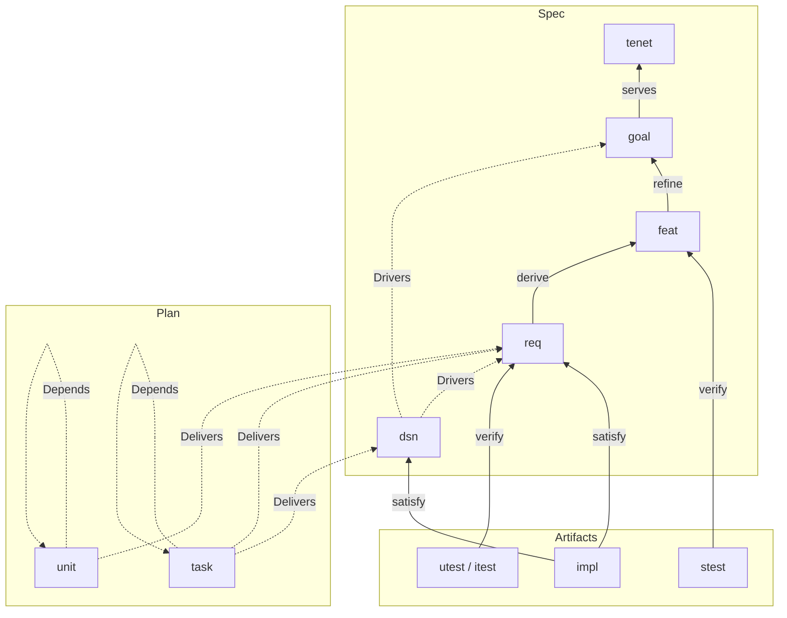
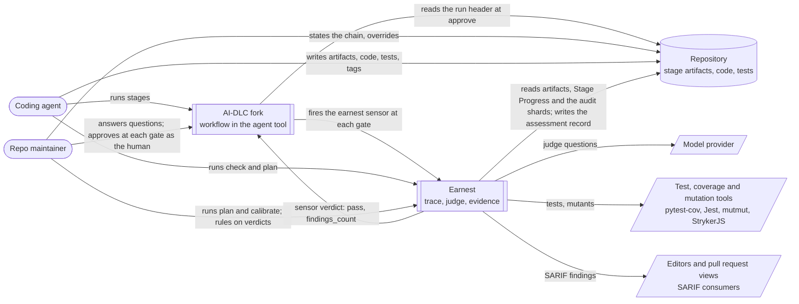
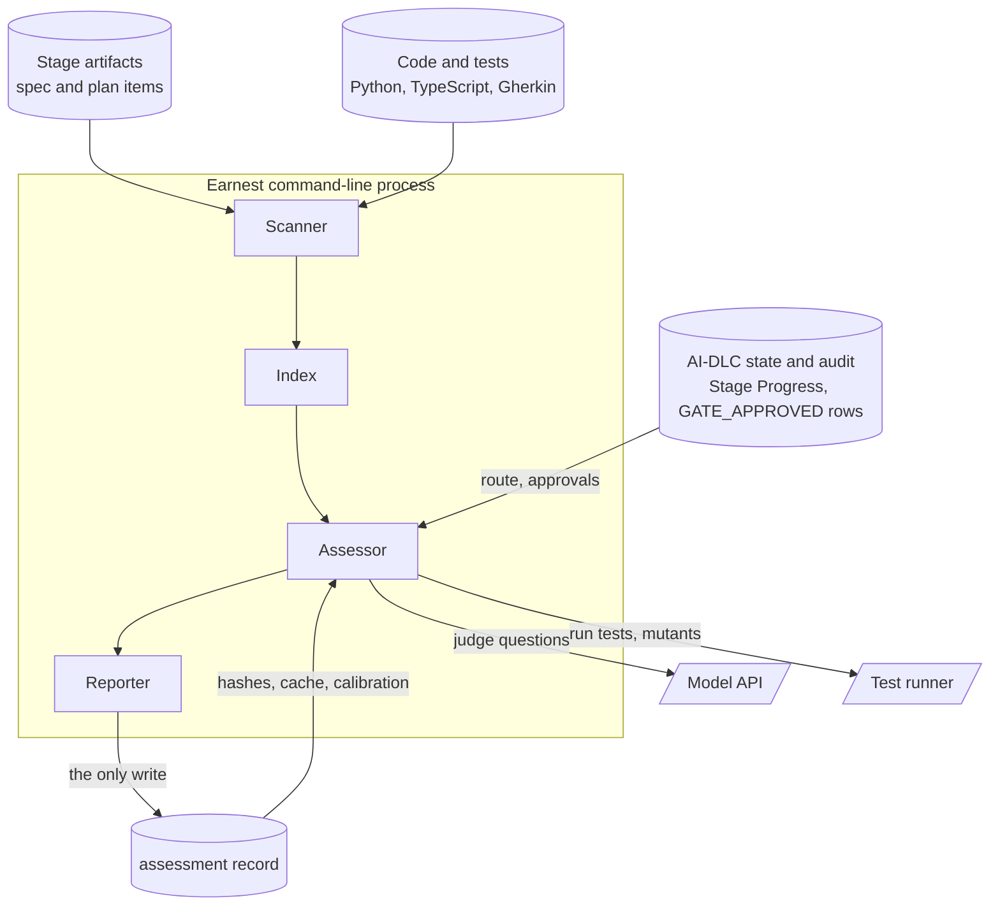
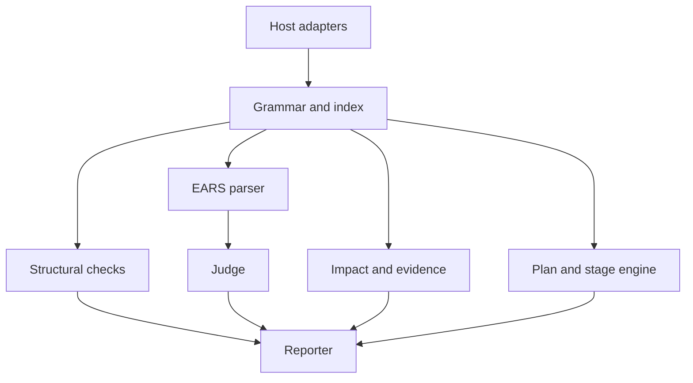
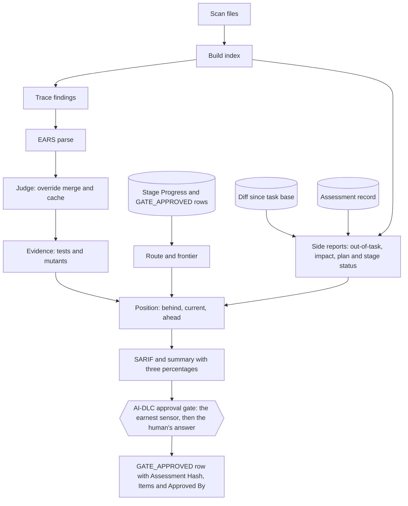

# 01 — Logic Design

Status: draft, derived from `00-project-intent.md`, September 2026.

## Context and problem

Delivery methods built for coding agents keep them on course with phases,
stages and human approvals. AI-DLC (`awslabs/aidlc-workflows`) is one such
method. It carries an intent from ideation through inception and construction
to operation, with an approval gate after each stage and an automated
verification gate at each phase boundary. It also records traceability, and the
agent that did the work writes it: each stage that traces writes a
`traceability.json` marking every upstream id `OK` against a target file, and
each unit of work writes a `source-manifest.json` listing the paths it changed.
A sensor then checks that the file is complete and that each target exists. In
the vocabulary of `00-project-intent.md` that trace is hearsay: a claim the
agent makes about its own work, checked for form.

Requirement tracing tools take the other route and derive links from tags in
the code. OpenFastTrace (OFT) reads a coverage tag in a comment, finds the
matching item in a Markdown spec, and reports the requirement as covered.
StrictDoc, sphinx-needs and LOBSTER do the same with different syntax. They
check that a link exists and stop there. Coding agents produce well-formed,
correctly revisioned tags at scale on code that only loosely relates to the
requirement, so a coverage report can read 100% while nobody can tell how far
"traced" has drifted from "done".

Earnest joins the two. It is a fork of AI-DLC that keeps the lifecycle and
replaces the agent-written trace with a derived one. Every stage artifact is
written with a small shared Markdown item syntax, code and tests carry tags in
OFT's syntax, and Earnest derives one trace from them. For every requirement it
answers in three layers of rising cost and confidence: traced (the tags
resolve), judged (a model, asked narrow questions, agrees the code and tests
match the clause), and evidenced (the tagged tests pass and kill mutants of the
tagged code). Agents run it on demand, from an editor or an agent session, to
see where their work drifted from the chain and from their current task. At
each stage boundary Earnest reports that stage's trace, verdicts and evidence,
and the human approves at AI-DLC's gate.

This document follows the fixed high-level design shape in
[[hld-documents-separate-solution-intent-from-implementation-detail-via-a-fixed-7]]:
`00-project-intent.md` holds intent (tenets T1–T8 and success criteria
SC1–SC11), and this document decides mechanism: how AI-DLC is adopted, the
domain model, the grammar, the key decisions, the logical architecture, the
interfaces and the runtime model. File and module layout belongs to
`02-structural-design.md`.

## Adopting AI-DLC

Earnest is a fork of `awslabs/aidlc-workflows`. It keeps AI-DLC's method and
changes two things: what the stage artifacts are written in, and where the
trace comes from (T8).

- **Kept.** The phases (Initialization, Ideation, Inception, Construction,
  Operation) and their stages; the specialist agents that lead and support each
  stage, such as the product, architect, design, developer, quality and
  delivery agents; the workflow profiles, such as classic, express, feature,
  enterprise and bugfix, that select which stages run; the human approval gate
  after each stage; the reviewer agents and the deterministic sensors such as
  the linter and the type check; the audit trail; and the harness integrations
  that run the same workflow in Claude Code, Codex CLI, Copilot, Cursor, Kiro
  and OpenCode, which gives the same results whichever agent tool drives the
  work.
- **Adapted.** Each stage artifact that states something the chain depends on
  is written with Earnest's item syntax, so its intent, features, requirements,
  decisions, units and plan steps are items with ids, revisions and edges (T5).
  The prose around the items stays AI-DLC's.
- **Replaced.** The agent-written trace and the automated checks over it.
  Every `traceability.json`, each unit's `source-manifest.json`, and the
  `traceability` and `upstream-coverage` sensors on every stage whose artifacts
  carry items give way to the trace Earnest derives from the artifacts and the
  code (T2); stages whose artifacts stay AI-DLC's keep AI-DLC's sensors. The
  phase-boundary verification gate, which writes a pass or fail
  `verification/phase-check-*.md`, gives way to the `earnest` sensor, which
  shows `earnest check` output to the human at each stage's approval gate. The
  human's answer is the approval; Earnest supplies what the human reads before
  answering, and AI-DLC's `GATE_APPROVED` audit row records the answer with the
  assessment it rests on (SC9).

An AI-DLC Unit of work, from Units Generation, is a `unit` item, and each step
of that unit's `code-generation-plan.md` is a `task`. A Bolt in `bolt-plan.md`
stays AI-DLC prose: a delivery slice over units. AI-DLC's permanent ids become
Earnest names by one rule: lower-case, with dots turned into hyphens, so `U1`
becomes `u1`, `FR1.2` becomes `fr1-2`, `NFR3` becomes `nfr3` and `ADR-001`
becomes `adr-001`. The table maps the AI-DLC artifacts that carry items; every
other artifact stays as AI-DLC writes it.

| AI-DLC stage | Artifact | Earnest item types | Treatment |
| --- | --- | --- | --- |
| Intent Capture | `intent-statement.md` | `tenet`, `goal` | adapted |
| Scope Definition | `scope-document.md` | `feat` | adapted |
| Approval and Handoff | `decision-log.md` | `dsn` | adapted |
| Requirements Analysis | `requirements.md` | `req` in EARS form, its FR and NFR ids named by the id rule | adapted |
| User Stories | `stories.md`, `personas.md` | prose citing `feat` and `req` ids | kept |
| Domain Design | `decisions.md` | `dsn` | adapted |
| Units Generation | `unit-of-work.md`, `unit-of-work-dependency.md` | `unit`, with `Delivers:` and `Depends:` | adapted |
| Delivery Planning | `bolt-plan.md` | prose grouping units into Bolts | kept |
| Functional Design | `entities.md`, `rules.md`, `functional-spec.md` | `dsn`, per unit | adapted |
| NFR Requirements | `security-requirements.md`, `performance-requirements.md`, `observability-requirements.md` | `req` in EARS form, per unit | adapted |
| NFR Design | `security-design.md`, `performance-design.md`, `observability-design.md` | `dsn`, per unit | adapted |
| Code Generation | `code-generation-plan.md` | `task`, one per plan step; computed status replaces the plan's checkboxes | adapted |
| Code Generation | application code and tests | `impl`, `utest`, `itest`, `stest` tags | adapted |
| Code Generation | `code-summary.md` | prose, the agent's account of its work | kept |
| Code Generation | `source-manifest.json` | the out-of-task check on the diff since the task's base | replaced |
| Build and Test | `test-results.md` | prose; the evidence layer runs the tests itself, and every `stest` is checked at this stage | kept |
| every stage whose artifacts carry items | `traceability.json`, the `traceability` and `upstream-coverage` sensors | the derived trace, through the `earnest` sensor manifest `aidlc-earnest.md` | replaced |
| each phase boundary | `verification/phase-check-*.md` | `earnest check` output at each approval gate, through the `earnest` sensor; the approval is AI-DLC's `GATE_APPROVED` row with the fork's `Assessment Hash`, `Items` and `Approved By` fields | replaced |

Each edge points to an item owned by the same stage or an earlier one, so each
stage can reach done at its own approval: a decision in `decision-log.md` names
goals, one in `decisions.md` names requirements or goals, a unit names
requirements, and a Functional Design or NFR Design decision names
requirements. The kept artifacts carry no weight as evidence (T2).

### The `earnest` sensor and the approval gate

`earnest check` runs inside AI-DLC as a sensor. The fork ships
`core/sensors/aidlc-earnest.md`, a manifest in AI-DLC's format with
`id: earnest`, `kind: deterministic`, `fire_on: gate`,
`default_severity: blocking`, `matches: "**/{aidlc-docs,intents,codekb}/**"`,
an `input_schema` of `output_path` and `stage_slug`, and an `output_schema` of
`pass` and `findings_count`. Its `command` is
`{{INVOKE}} engine sensor-earnest`, which AI-DLC resolves to the script
`core/tools/aidlc-sensor-earnest.ts`. The script receives
`--stage <slug> --output-path <path>`, derives the intent's
record directory from the path, runs
`earnest check --stage <slug> --intent <record dir>`, and prints `pass` and
`findings_count` as JSON with exit code 0. AI-DLC reads only the sensor's JSON,
so the script sets `pass` to true when `earnest check` exits
0 and to false when it exits 1 or 2. The script passes a bare slug and derives
no unit; M7 of `03` widens it to derive the unit directory from `output_path`
and pass `<phase>/<unit directory>/<slug>`, since a per-unit stage's bare slug
is ambiguous. Every
stage in the mapping table whose artifacts carry items, and the Build and Test stage, lists
`earnest` in its `sensors:` frontmatter in place of `traceability` and
`upstream-coverage`. The fork keeps the `sensors` ceremony on under every
workflow profile, so every such gate shows the check.

When a stage enters its approval gate, AI-DLC fires the sensor once for each
of the stage's deliverables that `matches` selects, and records
`SENSOR_FIRED`, then `SENSOR_PASSED` or `SENSOR_FAILED`, each naming the fire
id, the sensor id, the stage slug and the output path. Every fire checks the
whole stage, so every fire returns the same verdict. The gate shows the stage's
trace, verdicts, evidence, computed status and assessment hash. The sensor's
output carries the trace, verdicts and evidence; the gate reads the computed
status and the assessment hash from the stage's run header in the assessment
record. The sensor passes exactly when `earnest check` exits 0 (see Command
surface), and findings ahead of the frontier ride along as notes. On a failure AI-DLC
writes the sensor's JSON, which carries the
findings summary, to the detail file
`<record>/.aidlc-engine/sensors/<stage>/earnest-<fire id>.md` that the
`SENSOR_FAILED` row names. A failing sensor holds the gate until the agent
fixes the findings. AI-DLC holds a blocking gate the same way when the sensor
times out, exceeds its budget or returns malformed output, and the fork holds it
too when an artifact changes during the run, so a check that fails to run holds
the gate like a failing one. The human's escape hatch is AI-DLC's audited override, the gate
choice `Override blocking sensors`.

An approval is AI-DLC's own `GATE_APPROVED` audit row. Upstream the row
carries `Stage`, the human's `User Input` and any review-finding
dispositions, and only AI-DLC's approve transition in `aidlc-state.ts` writes
it. The fork extends that transition with three fields: `Assessment Hash`, the
assessment hash in the stage's latest run header; `Items`, the stage's item ids
with their revisions, such as `req~login-rate-limit~2`; and `Approved By`,
`human` or `automatic`. The fork adds them at the `GATE_APPROVED` emit site of
the approve path, and AI-DLC's audit validator accepts the three field names.
For per-unit stages M7 of `03` also writes the three fields and `Unit`, the
unit's name by the id rule, at the team gates' emit sites in `aidlc-state.ts`
and `core/tools/aidlc-unit.ts`, and `Unit` on the solo approve path, which
upstream writes without one.
The transition reads the hash and the items from
the run header that the sensor's `earnest check --stage` run wrote to the
assessment record, and the fork's approve transition confirms before approving
that the stage's artifacts are unchanged since the sensor ran. Request Changes records `GATE_REJECTED` as
AI-DLC does. Earnest reads these rows and writes none of them.

AI-DLC's `autonomous` mode, the `Construction Autonomy Mode` field that an
`AUTONOMY_MODE_SET` row grants, lets AI-DLC approve Construction's ordinary
completion gates itself, with no `HUMAN_TURN` since the gate opened. The
fork's approve transition marks such a row `Approved By: automatic` and a
human's answer `Approved By: human`. An automatic approval follows only a
passing `earnest` sensor, so no error-level finding sits at position behind or
current: the blocking sensor holds the gate on every other result, and AI-DLC
refuses the blocking-sensor override while the mode is `autonomous`, so an
unattended run halts at the finding. Plan Approval, summary confirmation when
it is on, verification command selection, skeleton approval and every sensor
failure stay with the human, as AI-DLC defines them.

The fork tracks upstream releases. Earnest's changes live in the stage
definitions and sensors they touch and in the approve transition's three
fields, and each upstream release is merged with those changes reapplied, so
upstream's stages, agents and harness integrations arrive unchanged.

## Goals

- **G1** Trace the whole chain from tenet to test on OFT's item model, keeping OFT's ID syntax, coverage semantics and link-status names as the reference. (T2, T8; SC1, SC2)
- **G2** Parse every `req` body as one of the five EARS forms so each requirement reads as prose and still yields a structure. (T5, T3; SC3, SC1)
- **G3** Report every requirement at exactly one trace level (untraced, traced, judged, evidenced) with located reasons and three separate percentages. (T6, T7; SC3)
- **G4** Model plan items (units and tasks) whose done-status is recomputed on every run from the trace levels of what they deliver, never typed. (T4; SC8)
- **G5** Check each change against the current task and turn anything outside it into a finding with exactly three exits. (T1, T6; SC6)
- **G6** Name the features a change impacts and the tests worth running, without running the full suite. (T6, T3; SC7)
- **G7** Build one index that the check and the judge share, so both report the same graph. (T3; SC1)
- **G8** Keep judge overrides in the prose files next to the item they override, keyed by id, revision and commit, so they expire with the revision and flag drift in the code. (T5, T7; SC11)
- **G9** Emit findings as SARIF plus a human summary, so one command's output tells an agent every change it needs. (T6, T8; SC2, SC10)
- **G10** Gate the judge on calibration against a maintainer's hand verdicts before the first AI-DLC unit the fork runs through Earnest. (T7, T3; SC4)
- **G11** Flag every item linked to an old revision, and every body edited without a new revision, in the same run. (T1, T4; SC5)
- **G12** Compute each stage's status from its items, place every finding behind, at or ahead of the frontier, and bind each approval AI-DLC records to the assessment it rests on. (T1, T4; SC8, SC9)
- **G13** Adopt AI-DLC's lifecycle, agents and harness integrations, replace its agent-written trace with the derived one, and deliver `earnest check` as an AI-DLC sensor. (T8, T2; SC1)

## Actors and use cases

Two actors use Earnest. The **coding agent** implements work, tags code and
tests, and runs Earnest to learn what to fix before it asks for approval. The
**repo maintainer** states and revises the chain, rules on judge verdicts,
approves each stage, and reads the plan. Either can run the reporting commands;
the use cases name who typically does. AI-DLC calls the person who answers an
approval gate "the human"; this document uses "the human" at AI-DLC's gates
and "maintainer" everywhere else, and both name the same person.

### UC1 Write the chain

- Actor: repo maintainer.
- Trigger: a new capability is wanted, and AI-DLC's Ideation and Inception
  stages run.
- Outcome: Markdown items exist in the stage artifacts for the goal, the
  features that refine it, the EARS requirements derived from each feature, and
  the `dsn` decisions that shape them; `earnest check` reports each parent
  without children as a gap.

### UC2 Tag and check before claiming done

- Actor: coding agent.
- Trigger: the agent believes its implementation is complete.
- Outcome: the agent has tagged code and tests, run `earnest check`, and
  received every gap, near-miss and weak verdict with file, line and position;
  it fixes those at position behind or current, or reports them, before asking
  for approval, and reads those ahead as work expected at the stage each one names.

### UC3 Check a change against the current task

- Actor: coding agent.
- Trigger: the agent is about to commit work on its current task.
- Outcome: every changed region outside what the task delivers is a finding
  offering exactly three exits: tag it under a requirement the task delivers,
  propose a task, or declare it blocked.

### UC4 Bump a revision

- Actor: repo maintainer.
- Trigger: a requirement's meaning changes.
- Outcome: the maintainer edits the item and bumps its revision; every tag,
  edge or stage approval at the old revision becomes an outdated finding, and
  that list is the agent's work list; overrides at the old revision expire.

### UC5 Override a judge verdict

- Actor: repo maintainer.
- Trigger: the maintainer disagrees with a judge verdict.
- Outcome: an `Override:` line under the item records the maintainer's verdict,
  the commit it was made at and the reason, for that revision; the next check
  reports the override as the observation of record.

### UC6 Ask what a change impacts

- Actor: coding agent or repo maintainer.
- Trigger: a change exists since the last approved stage check and the full
  suite is slow.
- Outcome: `earnest check` names the impacted requirements and features and
  the tests worth running, falling back to a conservative, flagged answer when
  a changed line has no coverage data.

### UC7 Ask the plan for status

- Actor: coding agent or repo maintainer.
- Trigger: someone wants the next stage or unit and what remains in it.
- Outcome: `earnest plan` prints the route with each stage's computed status
  and approval and the frontier, and the unit and task graph with each item's
  computed status and the plan findings.

### UC8 Run the calibration gate

- Actor: repo maintainer.
- Trigger: before the first AI-DLC unit the fork runs through Earnest, and
  whenever the judge model or prompt changes.
- Outcome: the maintainer runs `earnest calibrate` against a fixture; the judge
  runs over ten hand-tagged requirements, its verdicts are compared with the
  maintainer's, and the gate passes at eight or more matches (SC4).

### UC9 Approve a stage

- Actor: repo maintainer, as the human at AI-DLC's gate.
- Trigger: a stage enters its approval gate.
- Outcome: AI-DLC fires the `earnest` sensor, and the gate shows
  `earnest check --stage <stage>`: the stage's trace, verdicts, evidence and
  computed status, with the hash of that assessment. The human answers the gate
  as AI-DLC offers it, approve or request changes. On approve, AI-DLC's
  `GATE_APPROVED` row records the answer with `Assessment Hash`, `Items` and
  `Approved By: human` (SC9). Earnest reports; the human decides.

## Capabilities

Each capability satisfies named success criteria and surfaces in the output of
one of the commands in the Command surface.

| Capability | SC it satisfies | Where it shows |
| --- | --- | --- |
| Trace | SC1, SC2 | `earnest check`: trace findings and the traced percentage, on every run |
| Revision propagation | SC5 | `earnest check`: `outdated` and `unbumped-change` findings, on every run |
| Judge | SC3, SC4 | `earnest check --judge`: judge findings and the judged percentage |
| Calibration | SC4 | `earnest calibrate`: match count and pass or fail; `judge-uncalibrated` otherwise |
| Evidence | SC3 | `earnest check --evidence`: evidence findings and the evidenced percentage |
| Out-of-task check | SC6 | `earnest check`: out-of-task findings, when a current task and a change baseline exist |
| Impact | SC7 | `earnest check`: the impact section, when a current task and a change baseline exist |
| Plan and stage status | SC8 | `earnest plan`, and the plan status section of `earnest check`, with the frontier and each finding's position |
| Stage approval | SC9 | the `earnest` sensor at each gate; AI-DLC's `GATE_APPROVED` row carries `Assessment Hash`, `Items` and `Approved By`; `earnest plan` lists approvals |
| Overrides | SC11 | `earnest check`: the override as the observation of record, `override-expired` and `override-drift` |
| Report | SC3, SC10 | SARIF plus a summary that leads with three percentages |

## Domain model

### Item groups

The item types fall into three groups, and every type belongs to exactly one.

- **Spec**: `tenet`, `goal`, `feat`, `req`, `dsn`. These live in prose files,
  and every change to a spec item is the maintainer's decision. The spec says
  what must be true and why.
- **Plan**: `unit`, `task`. These also live in prose files. The plan says
  in what order the spec gets delivered.
- **Artifacts**: `impl`, `utest`, `itest`, `stest`. These are tags in code and
  test files, written by whoever writes the code, usually the coding agent.
  Artifacts claim to satisfy or verify spec items.

Throughout this document, "spec" means the first group, "the plan" the second,
and "prose files" the Markdown stage artifacts that hold both spec and plan
items.

### Item types

| Type | Source standard | Body rule (what the scanner checks) | Edges it carries | Checked by |
| --- | --- | --- | --- | --- |
| `tenet` | spec-kit constitution / SysML concern | — | none; the root of the spec | trace, as the root |
| `goal` | spec-kit success criterion / SysML top-level requirement | — | `Covers:` `tenet` (serves) | trace |
| `feat` | OFT `feat`; Cockburn use-case form by convention | — | `Covers:` `goal` (refine) | trace |
| `req` | EARS + OFT `req` | body parses as one of the five EARS forms | `Covers:` `feat` (derive) | trace, judge |
| `dsn` | OFT `dsn`; MADR body by convention | — | `Drivers:` `req` or `goal` | trace |
| `impl` | OFT | tagged code region | `Covers:` `req` or `dsn` (satisfy) | trace, judge, evidence |
| `utest` / `itest` | OFT test types | tagged test | `Covers:` `req` (verify) | trace, judge, evidence |
| `stest` | OFT test type; a Gherkin scenario | tagged scenario | `Covers:` `feat` (verify) | trace, evidence |
| `unit` | AI-DLC Unit of work | — | `Delivers:` `req`; `Depends:` `unit` | plan status |
| `task` | a step of AI-DLC's `code-generation-plan.md`; spec-kit tasks file | — | `Delivers:` `req` or `dsn`; `Depends:` `task` | plan status |

Only `req` has a body rule. The use-case form for `feat` and the MADR sections
for `dsn` are writing conventions the scanner leaves unchecked. An ATX
heading ends an item (see Grammar), so those sections are labelled paragraphs
or list items inside the body, as in the Key design decisions section. Only
`tenet`, `goal`, `unit` and `task` are additions to what OFT ships. OFT treats
artifact types as free-form strings and reads the new key lines as prose, so
the prose files stay readable by OFT.

### Edges

Four keys carry edges.

- **`Covers:`** is OFT's, with OFT's meaning: the child claims to serve,
  refine, derive from, satisfy or verify the parent. A cover counts toward
  coverage only when the parent needs the child's type; OFT reports any other
  cover as `COVERED_UNWANTED`. That is why decisions use `Drivers:` in place of
  `Covers:`.
- **`Drivers:`** runs from a `dsn` to the `req` or `goal` ids that drive it.
  OFT reads it as prose, and it never counts toward coverage.
- **`Delivers:`** runs from a `task` to a `req` or `dsn`, and from a `unit`
  to a `req`. It never counts toward coverage.
- **`Depends:`** runs from a `task` to a `task`, and from a `unit` to a
  `unit`. A unit's tasks are the steps of the `code-generation-plan.md` in that
  unit's construction directory, which the `Unit ID` and `Directory` table in
  `unit-of-work.md` joins to the unit's id, so a unit never names a task.



Solid arrows are `Covers:` and count toward coverage; dotted arrows are
`Drivers:`, `Delivers:` and `Depends:` and never count toward coverage. `tenet`
is the root of the full chain: a tenet with no goal serving it is a gap, and a
goal serving no tenet is orphaned. A shorter workflow profile moves the root
down, as the route rule under Stages states.

### Default Needs

When an item has no `Needs:` line, its type's default applies; an explicit
`Needs:` line wins. Test tiers attach to the spec, never to the plan. The route
rule under Stages drops any default that names a type the route never
produces.

| Type | Default `Needs:` |
| --- | --- |
| `tenet` | `goal` |
| `goal` | `feat` |
| `feat` | `req`, `stest` |
| `req` | `impl` plus its declared test tier, `utest` by default |
| `dsn` | `impl` |

A cover by a tier the requirement never declared is reported as unwanted, and
the declared tier stays a gap until a cover of that tier exists.

### Findings

Every finding has a rule id, a level, a location and a position (see Frontier
and position, which also places a finding that reaches no stage). The Level
column is the SARIF level at position behind or current, except for a stage
approval's `outdated`, which is a note at every position; at position ahead
every finding is a note. The first five reuse OFT's link-status names; the
rest are Earnest's.

| Rule id | Level | Meaning |
| --- | --- | --- |
| `earnest/outdated` | error; note for a stage approval | a tag or edge names an older revision of an existing item; the message names the current revision. A stage approval that names an older revision is the same finding at level note, at the position of the stage that awaits its fresh approval |
| `earnest/predated` | error | a tag or edge names a revision above the item's current one |
| `earnest/unwanted` | warning | a cover by a type the parent never needs, so it counts toward nothing |
| `earnest/orphaned` | error | a tag or edge names an id absent from the index, or an item covers no parent; the message suggests the closest existing id |
| `earnest/duplicate` | error | two items share an id, or two `Override:` lines share an id and kind |
| `earnest/near-miss` | error | text nearly matches a tag surface, an id line or a key-line value; the message gives the canned fix |
| `earnest/req-not-ears` | error | a `req` body fails the EARS grammar; the message lists the five templates |
| `earnest/gap` | error | an item lacks a child its `Needs:` requires |
| `earnest/unplanned` | warning | a `req` is delivered by no task |
| `earnest/cycle` | error | the plan's dependency graph has a cycle |
| `earnest/route-mismatch` | error | a stage row of the state file's Stage Progress that is marked EXECUTE carries the skipped mark with no counting `STAGE_SKIPPED` row, or a Stage Progress row, or the section itself, that Earnest cannot read; the message names the stage and the audit row that is missing, or the line Earnest cannot read. On a units route it is also a unit table, table row or `unit` item that the join of Per-unit stages and units cannot use. A Stage Progress finding reaches no stage; a unit-table finding counts against Units Generation |
| `earnest/out-of-task` | warning | a changed region lies outside what the current task delivers; the message offers the three exits |
| `earnest/override-expired` | warning | an `Override:` line names a revision other than the item's current one |
| `earnest/override-drift` | warning | the region an override covers changed since the override's commit; the judge reruns and both verdicts show |
| `earnest/unbumped-change` | error | an item body changed while its revision stayed the same, after a counting approval named that revision (see Revision lifecycle) |
| `earnest/impact-degraded` | note | a changed line has no coverage data, so impact selected a conservative set |
| `earnest/judge-uncalibrated` | warning | the judge ran with no passing calibration for the current model and prompt |
| `earnest/judge-not-satisfied` | warning | the judge answered a question with not-satisfied |
| `earnest/evidence-failed` | error | a tagged test fails, or a mutant inside a tagged region survives |

### Trace levels

A requirement's trace level is one field with four values, in order:

- **untraced**: some needed cover is missing or fails to resolve.
- **traced**: every needed cover resolves at the current revision.
- **judged**: traced, and every judge question is satisfied or overridden.
- **evidenced**: judged, and the tagged tests pass with no surviving mutant in
  the requirement's regions.

### Computed status

Status is recomputed from the graph on every run.

| Item | Done when |
| --- | --- |
| `task` | every `Delivers:` id resolves at its current revision, each delivered `req` is at trace level evidenced, and each delivered `dsn` is traced (an `impl` covers it) |
| `unit` | a unit-table row gives its directory, it is resolved in unit order (see Per-unit stages and units), every unit it depends on is done, and its `code-generation-plan.md` holds a task and every task in it is done |

A requirement reaches evidenced only from a `passed` `evidence` entry of the
assessment record whose key matches its current regions, tests and mutation tool; any other entry, or
none, leaves it short of evidenced. Only a requirement the same run judged
gets a `passed` entry, so where no model runs a matching one stands for judged
too. `earnest check` and the read-only `earnest
plan` both read the entry and hash the regions themselves, so either shows a
task as done without running a test, and an edit under a requirement drops it
below evidenced until `earnest check --evidence` runs again.

A feature's `stest` going green is checked at the Build and Test stage, which
runs once across the completed unit work.

A stage's status is `done` or `not done`, by the three conditions under
Frontier and position. Its reasons are the number of error-level findings
that count against it, the number of its tasks that are not done, and its
approval, `current`, `outdated` or `none`. Stage status is a fact about the
graph, so a stage whose only open condition is its approval reads `not done`
at its gate.

### Stages

A stage is one AI-DLC stage run, named by its path in the intent's record
directory, such as `inception/requirements-analysis` or
`construction/u1-checkout/code-generation`, where `u1-checkout` is the unit's
directory from `unit-of-work.md`; a route without Units Generation runs Code
Generation once, at `construction/code-generation`. The path is the stage's id, so nobody
writes a stage item. A stage's items are the items in the artifact files under
that path. Code and test tags reach a stage through the tasks that deliver
what they cover, and every `stest` reaches the Build and Test stage.

The workflow profile, stored as `Scope` in the intent's `aidlc-state.md`,
selects the route, and the state file records it: its Stage Progress section
lists every compiled stage under a heading for its phase, with the word EXECUTE
or SKIP. The route is the rows marked EXECUTE outside the Initialization phase,
in the order the rows stand, less each stage that a counting `STAGE_SKIPPED` row
in the audit log skips (see Frontier and position). Initialization's stages hold
no approval gate, so they are not on the route. A stage's id is its phase and
slug, such as `inception/requirements-analysis`; a route that holds
`units-generation` also has per-unit stages (see Per-unit stages and units).
Earnest reads the route as configuration. It
never reads the checkbox marks as status; it compares a skipped mark on an
EXECUTE row with the audit log, and such a row with no `STAGE_SKIPPED` row,
like a Stage Progress row or section it cannot read, raises
`earnest/route-mismatch`. The route rule: needs and edges that name an
item type no stage on the route produces are dropped, and the chain root is the
highest type reached by climbing from `req` through types the route produces.
Enterprise, Feature and MVP run Intent Capture and Scope Definition, so they
keep the full chain with `tenet` as root. PoC runs Intent Capture and skips
Scope Definition, so it has `tenet` and `goal` without `feat`; the climb from
`req` stops at `req`, which is the root. Classic, Workshop, Express, Bugfix,
Refactor, Infrastructure and Security patch skip Ideation, so no `tenet`,
`goal` or `feat` exists there and `req` is the root. PoC, Bugfix, Refactor,
Security patch and Express skip Units Generation, so their tasks stand without
a unit and Code Generation writes to `construction/code-generation/`.
Infrastructure also skips Units Generation and runs no Code Generation or
Build and Test, so its route has no tasks.

### Frontier and position

Earnest reads approvals from AI-DLC's `GATE_APPROVED` audit rows and never
reads the stage checkboxes in `aidlc-state.md`, which the agent writes (T2).
An approval is read from the `GATE_APPROVED` rows of the intent's audit shards.
The intent's record directory is `aidlc/spaces/<space>/intents/<dir>/`, and its
audit log is every `audit/*.md` shard in it, read as blocks split on a `---`
line, each field a `**Field**: value` line, with the block's first `Timestamp`
as its time. The rows are ordered by timestamp, then by shard file name, then by position in
the shard. A row for a stage counts only if it follows the latest
`WORKFLOW_STARTED` row and every `STAGE_JUMPED` row whose reset span includes the
stage: a BACKWARD jump resets its target and every later row of the state
file's Stage Progress that is marked EXECUTE, skipped marks included, a REDO
jump resets its target, and a FORWARD jump resets none. A stage's approval is
the latest counting row for it, unless a counting `GATE_REJECTED` row for the
stage follows it, which leaves the stage with none. On a stage that is not
per-unit, a row that carries `Unit`, `Gate Scope` or `Gate Stages` is not read.
An approval is current when the item ids and revisions its `Items` field names
match the stage's current ones; a row without an `Items` field is current and
never goes stale. Rows that do not count, and earlier rows, are history and
raise nothing. A `STAGE_SKIPPED` row counts under the same rules as an approval
row, so a skip row before the boundary, or inside a reset span, stops counting
and its stage is on the route again. The frontier is the first stage on the route without a
current approval.

Every finding carries a position, taken from the stage it counts against; an
out-of-task finding counts against the current task:

- **behind**: the stage is approved and sits before the frontier. The finding
  is a regression: the approval still names the stage's current revisions, so
  the frontier stays where it is, and the stage reads not done until the agent
  fixes the finding.
- **current**: the finding lies in the frontier stage, its unit's frontier
  stage or the current task. It is in scope, and it is the agent's work now.
- **ahead**: the stage comes after the frontier. The finding has SARIF level
  note, its message names the stage where the work is expected, such as
  "expected at construction/u1-checkout/code-generation", and the agent takes
  no action on it.

A plan finding counts against the stage whose artifacts hold the plan items it
is about, as a `gap` counts against the stage whose artifacts hold the missing
child's type. `earnest/unplanned` counts against the Code Generation stage
whose unit delivers the requirement, or against the first Code Generation stage
on the route when no unit does; on a route that holds `units-generation` it
counts instead against the Code Generation stage of the lowest-named unit with
a valid row of the unit table that delivers the requirement, else of the
lowest-named unit with a valid row, and against Units Generation when no unit
has a valid row (see Per-unit stages and units); a route without a Code
Generation stage, read before the per-unit expansion, holds no tasks, so it
raises no `earnest/unplanned` finding. The rule reads the route
and needs no task to exist. `earnest/cycle` counts against the stage that holds
the items in the cycle, is located at the id line of the first item of the cycle
in id order, and its message lists the cycle as
`task~a~1 -> task~b~1 -> task~a~1`.

A finding that reaches no stage keeps its level and sits at position current
in every run, `--stage` runs included, whatever the frontier, so an error
there fails the check (see Command surface) and the `earnest` sensor at each
gate until it is fixed. It names no stage. Such findings include an orphaned
or near-miss tag, which covers nothing a task delivers; a malformed id, which
resolves to no item; and every finding of a run with no plan, where no Stage
Progress gives a route, and so no stage exists.

At the start of an intent the frontier is the first stage on the route, so
only that stage's work reads as current and everything further along reads as
expected; each approval moves the frontier on and brings the next stage's
required work into view. The out-of-task check still reports
changed code outside the current task.

A stage is done when all three hold, recomputed on every run:

1. No error-level finding counts against the stage. A `gap` whose missing
   child belongs to a downstream stage counts against the stage whose
   artifacts hold that child's type, and takes that stage's position.
2. Every `task` among the stage's items is done, so a Code Generation stage
   needs every requirement it delivers at trace level evidenced, and the Build
   and Test stage needs every `stest` on the route passing.
3. A current approval exists for the stage.

A spec stage can therefore be done before any code exists, and a construction
stage is done only when the evidence says so. An approval whose items have
since moved to a new revision raises `outdated` at level note (see Findings),
located at each such item;
the approval stops being current, so the stage becomes the frontier again and
waits for a fresh approval.

### Per-unit stages and units

On a route that holds `units-generation`, Earnest reads by raw read the first
table outside a code fence in `inception/units-generation/unit-of-work.md`
whose header holds `Unit ID` and `Directory`. A row's unit name is its
`Unit ID` by the id rule, a name of the grammar; its directory is one path
segment of lower-case letters, digits and hyphens that names no Stage Progress
slug. A row that cannot be read, repeats an earlier row's name or directory, or
names no `unit` item, and a `unit` item that no row names, raises
`earnest/route-mismatch` at its line, in the Units Generation stage; a table
that is missing, a symlink or unreadable raises it at the state file's
`units-generation` row. A row that raises one stands for no unit. Unit Progress
is never read.

Unit order ranks every `unit` item in the intent's record directory. A
`Depends:` entry of a unit counts when it names, by type and name, a `unit`
item there; any other entry is unknown, and an entry naming a task or another
intent's unit raises no finding of its own. Earnest repeatedly takes, among the
units not yet taken that have no unknown entry and depend only on taken units,
the one with the lowest name, compared by code point (`u10` before `u2`). A
unit Earnest never takes, one on a dependency cycle, with an unknown entry or
depending on such a unit, is unresolved; the unresolved units follow the taken
ones in name order, and none of them is done. `properties.plan` lists units in
unit order and tasks by id. Each EXECUTE row on the route whose slug is
`functional-design`, `nfr-requirements`, `nfr-design`, `infrastructure-design`
or `code-generation`, upstream's `for_each: unit-of-work` set, stands in place
once for each unit a row joins, in unit order, as
`<phase>/<unit directory>/<slug>`, and for no stage when no row joins a unit.
Unit order sets the order of the route's per-unit stages and of the unit list,
and so which per-unit stage the route's frontier names; each unit's lane is
unchanged by it, and no finding's stage or position depends on it, because the
`gap` and `unplanned` fallbacks choose by lowest lexical unit name, not by
route order. The route rule reads the route before this expansion, and
every file under `<phase>/<directory>/<slug>/` of such a row is in the
evaluated tree, so an unusable table drops no need and no file.

A gate row speaks for a per-unit stage only through a `Unit` equal to a unit's
name. With no `Gate Scope`, or `per-stage`, and a `Gate Stages` absent or equal
to its `Stage`, it speaks for that unit's stage of its `Stage`. A `unit-end` row
whose `Gate Stages`, split as `Items` is, lists its `Stage` and only per-unit
stages on that unit's route speaks for each of them, and is current when its
`Items` are the items of all of them. Any other row, `unit-merge` included,
approves nothing. A unit's generation is the highest `Attempt Generation`, a
whole number of at most nine digits and 0 when absent, on its structurally
counting approval and rejection rows (per-stage or unit-end; unit-merge and
non-counting scopes do not raise the maximum, and an unknown `Unit` has no
maximum unit); an approval below it, or whose value is no whole number,
approves nothing, and such a value raises no generation. A counting rejection
voids what it would approve, else its `Stage` for its unit, or for every unit
when its `Unit` names none; no generation discounts it. Upstream's solo approve
path writes no `Unit`, so before M7 of `03` it approves no per-unit stage. A
`STAGE_SKIPPED` row carrying `Unit`, `Gate Scope` or `Gate Stages` skips
nothing, and restarts and jumps void rows by slug for every unit.

A unit's lane is the route less the other units' per-unit stages; its frontier
is the first stage on its lane without a current approval. A finding in a
per-unit stage takes its position from its unit's frontier, any other from the
route's, so one unit's error never reads ahead because another unit's frontier
sits earlier, and a stage after the per-unit stages reads ahead until every
unit's are approved. A `gap` whose producing stage is per-unit counts against
that stage of the unit whose stage holds the item, else of the lowest-named
unit with a valid row that delivers it, else of the lowest-named unit with a
valid row; `unplanned` counts against the Code Generation of the lowest-named
unit with a valid row that delivers the requirement, else of the lowest-named
unit with a valid row. Names compare by code point. A unit with no row, or
whose row is invalid, owns no fallback. With no unit with a valid row both
count against Units Generation.

A `--stage` run of a stage ahead of its unit's frontier reports that unit's
errors there as notes and can exit 0, so a `unit-end` gate that fires its
sensor at its final stage is not shown safe before M7 of `03` (see Open
questions). A `Directory` edit changes no item body, so it neither stales the
Units Generation approval nor raises `unbumped-change`; per-unit approvals go
stale through their `Items`.

### Process vocabulary

The vocabulary for one run of Earnest comes from OSCAL's assessment model.
Tests already "verify" in the edge vocabulary, so the process avoids that word,
and it avoids "control", which implies a compliance catalogue.

| Term | Meaning |
| --- | --- |
| assessment | one run over the repository at a commit |
| observation | what one check saw about one edge for one question: method (`trace`, `inspection`, `test`), subject, result, reasoning, location |
| finding | a located result with a rule id and level, rolled up from observations |
| override | a human-authored observation that replaces the judge's for one item, revision and kind |
| approval | AI-DLC's `GATE_APPROVED` audit row accepting one stage, carrying, once the fork writes them, `Assessment Hash` (the hash of the assessment the gate showed), `Items` (the stage's item ids and revisions) and `Approved By` (`human` for the human's answer, `automatic` under AI-DLC's `autonomous` mode); a row without them counts as current and freezes nothing (see Frontier and position); like an override it is an act of record, and no item carries it as a typed status |

SARIF is the findings contract: every finding and the observations behind it
travel in the SARIF output. Earnest writes one thing: the `.earnest/`
directory, which holds the assessment record, its ignore marker and the
coverage maps of the Impact rule under `.earnest/coverage/`. The record holds
six things:

1. the run header of each stage that `earnest check --stage` ran: commit,
   `dirty` (as the Assessment hash section defines it),
   timestamp, layers run, model id and prompt hash, the stage, its item ids and
   revisions, its computed status and the assessment hash;
2. the body hash of every item of a stage that `earnest check --stage` ran,
   keyed by id and revision;
3. the commit the coverage map was taken at;
4. the judge cache;
5. the latest calibration result;
6. the latest evidence result of each requirement, keyed by id and revision,
   with the hashes of its covered regions and covering tests and the mutation
   tool it ran under.

The judge cache key is the item's id and revision, the question, the hash of
the covered regions, the hash of the covering tests, the model id and the
prompt hash. A hit reuses the observation; any change in the key reruns the
question.

### Override rule

An override is an `Override:` line under the item, naming the item's id and
revision, a kind, the commit it was made at, and a reason.

- `implemented` replaces the judge's inspection observations on `impl` edges;
  `tested` replaces them on test edges.
- A revision other than the item's current one raises `override-expired`, and
  the override drops out of the verdict.
- Two overrides with the same id and kind raise `duplicate`.
- When a region the override covers changed since its commit, the override
  raises `override-drift`, the judge reruns, and the report shows both verdicts.

### Revision lifecycle

Change flows top-down, and Git holds the history while the revision carries the
semantic version. Every step below is reported in the run that follows the
change (SC5).

1. A spec item's body changes, and the maintainer bumps its revision in the
   same change. Edits to key lines alone need no bump.
2. A body that changed at the same revision after a counting `GATE_APPROVED`
   row named its id with that revision raises `unbumped-change`: its hash
   differs from the one the assessment record holds for that id and revision.
   `earnest check --stage` records an item's hash when none is held for its id
   and revision, and replaces it on each later run until such a row exists.
   From then on the held hash stays as it was, so the finding stands until the
   revision is bumped or the text is restored. A row that is voided (rejected,
   before the latest `WORKFLOW_STARTED`, or jumped over; see Frontier and
   position) no longer counts, and the held hash is free again. A held hash
   that no counting approval names is no baseline, and no finding rests on it.
   The hash is the SHA-256 of the UTF-8 bytes of the body's non-blank lines
   joined by line feeds, with no final line feed. The body is the item's lines
   after its id line, up to the next id line or ATX heading, as the Grammar
   section delimits it: key lines are left out and fenced lines count as body,
   so adding, moving or removing a key line and the blank lines around it leaves
   the hash as it was. The text is the decoded text the scanner reads, with a
   carriage return before a line feed removed, trailing spaces and tabs removed
   from each line, and a line blank when nothing is left of it. An item with no
   held hash has no baseline, and the summary says so.
3. Staleness propagates exactly one edge: bumping X makes every tag, `Covers:`
   and `Delivers:` that names X at the old revision `outdated`, located at that
   line.
4. Edges in the prose files resolve exactly as tags do. A missing id is
   `orphaned`, and a task with an unresolved `Delivers:` is never done.
5. The agent updates code and tests and re-tags at the new revision; the judge
   reruns for the item.
6. Overrides at the old revision expire.
7. An approval that names X at the old revision becomes `outdated`, and the
   stage that holds X needs a fresh approval.
8. A superseded decision is a revision bump of its `dsn`, with a prose line
   naming what it supersedes. Bumping a `tenet` or `goal` behaves like any other
   bump.

### Region rule

A tag governs the lines from itself to the next tag in the same file, or to the
end of the file. Consecutive tags with no code between them share the region
that follows them. Repeated tags for one id govern the union of their regions.
The scanner derives regions on every run, so nobody maintains them by hand.

### Out-of-task rule

Earnest never reads a Git branch, a branch name, a merge-base or
`refs/remotes/origin/HEAD`: by the maintainer's decision no check runs against
Git branches. The task change is read from the plan state and the assessment
record alone.

The current task comes from `--task`, or else from the plan state, by the
maintainer's ratified decision: a line
`- **Current Task**: <task id>` in the `## Project Information` section of an
intent's `aidlc-state.md`, read as `Scope` is read, naming one `task` item of
that intent on type and name, revision ignored. With no such line in any
intent, more than one such line across the intents, or a value that is not one
id naming a task of its intent, there is no current task, and the summary says
so in one line. The state file is the stage state that AI-DLC keeps and
Earnest already reads by raw read; it lies outside the evaluated tree, so
moving the current task changes no body hash, no assessment hash and no diff.
The line names the work in scope and decides no status, so Earnest still reads
no checkbox mark as status (Stages).

The change baseline is the commit of the last approved stage check of the
current task's intent, as the assessment record holds it. Among the stages on
that intent's route that have an approval, current or outdated, as Frontier
and position and Per-unit stages and units read it, Earnest takes each whose
approval row carries an `Assessment Hash` equal to the `hash` of the run
header the record holds for that stage; the baseline is the `commit` of the
header whose approval row comes last in audit order. When one row approves
several such stages, as a unit's end gate approves its per-unit stages
together, the stage later in route order gives the baseline: the choice is
deterministic, and the last stage in route order is the furthest-progressed
state. The approve transition
copies the hash from the header, so an equal hash shows that the header is
the one the human approved, and a later stage check of that stage, which
replaces the header, ends the stage's claim. An outdated approval still
counts, so a revision bump during the task leaves the baseline where it was.
A row without `Assessment Hash`, as upstream writes before M7 of `03`, gives no
baseline. The commit is read whether or not the header was `dirty`, so what
was uncommitted at the approval reads as changed. With no such stage, or a
commit that Git no longer holds, there is no baseline, and the summary says so
in one line. A current task that lies in no intent's record directory, as a
task item in a plain document can, has no intent and so no baseline: the check
runs without the task change, and the summary says once that the task lies in
no intent, while the exit code is untouched. The baseline is per intent, and
an existing task id is no usage error, so this is not the exit 2 of a `--task`
that names no task. A record whose `commit` is not a string names no commit
and so gives no baseline either. These readings are the smallest that the record already
supports: it keeps one header per stage and the audit log the approvals, so
no new record key is needed.

The out-of-task check runs with a current task and a change baseline. It reads
the diff since the baseline and matches each changed region's tags to the task's `Delivers:` ids on type and
name, ignoring revision. A region already reported `outdated` raises no
`out-of-task` finding. Every other changed region outside the task's items is
`out-of-task`, offering exactly three exits:

- tag it under a requirement the task delivers;
- propose a task, as a new task item in the diff, which is a plan change for
  the maintainer to ratify;
- declare it blocked, as a message to the maintainer rather than an item.

The first two exits clear the finding. A changed region is not out-of-task
when the diff adds a task item, one whose id line is a changed line, whose
`Delivers:` names one of the region's tags on type and name, and the hunk
that adds such a task item is the proposal itself and raises no
`out-of-task`. After a declared block the region still lies outside the
current task, so the finding stands.

The diff runs from the baseline to the work tree, untracked files
included, and covers only the files the scanner reads, the evaluated tree of
the Assessment hash section: a region exists only in a scanned source, so a
skipped file such as an audit shard or the state file has no changed region.
A changed region is a tag region, by the Region rule, that holds a changed
line, or one hunk of changed lines that lie outside every tag region; changed
Markdown prose, which holds no tag, is such a hunk. A region is already
reported `outdated` when an `outdated` finding is located on one of its
lines. An `out-of-task` finding is located at its region's first changed
line. It counts against the current task: its `properties.stage` is the stage
that holds the task, and its position is current. The check runs only when a
current task and a baseline exist. The rule is read literally and keeps prose in scope, so a
spec edit outside the task's requirements is out-of-task
work too. A change that only deletes lines holds no changed line, so it forms
no region and raises no `out-of-task`, read literally; deleting the code of
another requirement is a known limit of the check. A task item added in the
diff clears only through the regions whose tags its `Delivers:` names, and
only the hunk of such a task item is the proposal that raises none; a hunk
that adds a task delivering none of the changed regions' tags is out-of-task
like any other. Without a current task or a baseline the check runs without
the task change: no `out-of-task` finding, no impact section and no
`impact-degraded` finding, and the summary gives the reason in one line, which
is no SARIF result, so the findings of a run without the task change are those
of M2. Failing the whole check for want of either would take
the trace, plan and stage status away from a repository that M1 and M2
already check.

### Impact rule

Impact reads dynamic per-test coverage contexts: pytest-cov with
`--cov-context=test`, and Jest with `--findRelatedTests`. The coverage map is
taken by each `earnest check --stage`, at commit A, the HEAD of that run, and
is stored under `.earnest/coverage/<A>`, ignored by
Git as the record is; the record keeps only the commit A. A map holds the
line numbers of the bytes the tests ran, so it is taken only from a clean
work tree, one that is not `dirty`: a dirty tree is not commit A, and its map
would remap wrongly. A stage check of a dirty tree takes no map, leaves every
earlier map and the record's `coverage` as they were, and says so in the
summary. The map run reads no stdin and stops after 900 seconds, so a test
that hangs cannot hang the gate. A run that times out, that pytest ends with
exit code 2 to 5 (interrupted, internal error, usage error, no tests
collected), or that leaves no or empty coverage data, gives no map: no
placeholder is written, the record's `coverage` stays as it was, and the
summary names the cause, while the check's exit code is untouched. Failing
tests, exit code 1, still give a map, as the contexts of a failing test are
still what it ran. Earnest's own options to the map run write nothing outside
`.earnest/`: no cache, bytecode, log file or `.coverage`, with the
repository's `addopts` and coverage configuration left out; the repository's
tests themselves run under the trust model of the test suite (see Runtime and
permission model). For a diff from A to B, unchanged lines are remapped
through `git diff A..B`, deletions included, so a line that a deletion since
A moved is read at its line in A. Impact reads the map of the change
baseline, `.earnest/coverage/<baseline>`, and no other, so A is the baseline.
Impact reads the same changed lines as the out-of-task check, and runs exactly
when it does, with a current task and a baseline: the baseline belongs to the
current task's intent, and without a task no intent's baseline is the one to
read, so impact without a task would be a second, separate rule. A modified line is seen
through the base line its diff hunk pairs it with, and selects the tests whose
contexts covered that line. A changed or new line the map never saw selects
every test tagged to a requirement whose region contains it, a test tag
matching the requirement on type and name; when no such requirement exists,
impact selects the full suite and raises `impact-degraded`. The full suite is
every test the map holds a context for, and with no map it is written as no
test, with impact marked degraded. A line deleted since the baseline
selects the tests whose contexts covered it in the baseline's map, the
only map whose lines are the baseline's; with no such data, no map for the
baseline, or no context for that line in that map, as for
a blank line, a comment or the continuation of a statement whose context
coverage gives to its first line, it selects the full suite and raises
`impact-degraded`, located at the line of the work tree the deletion follows,
and naming the deleted line's number in the baseline. A deleted line names
no requirement, as its region is gone. A file deleted since the baseline is read
the same way, every base line of it a deleted line, although the evaluated
tree no longer holds it: impact reads such a file when the scanner would read
its path, by its suffix and outside the bookkeeping of a record directory
read by the current intents, so a deleted audit shard or state file raises
nothing. Its findings are located at line 1 of the deleted path, its uri as
the baseline holds it, and are placed as every finding is: a deleted stage
artifact counts against its stage, and deleted code or tests reach no stage.
The out-of-task check reads no deleted file, as a deletion forms no region. `impact-degraded` is one finding per
such line, changed or deleted, blank lines included, read literally and so
deterministically. It
counts against a stage by the placement every finding follows: a line in a
stage artifact counts against that stage, and a line of code or tests in no
tag region reaches no stage. The output names the impacted requirements (the
requirements the tags of the changed tag regions name, by type and name at
their current revision), the features they derive from, and the tests worth
running.

### Evidence rule

The evidence layer runs mutmut for Python and StrykerJS for TypeScript on the
files that hold tagged regions, and leaves test selection to those tools. A
failing tagged test, or a surviving mutant inside a tagged region, raises
`evidence-failed` against every requirement that region's tags cover.

### Invariants

- Every spec item traces to a parent, except the chain root.
- Every parent has the children it needs, or it is a gap.
- Done is computed from the graph and evidence, for tasks, units and stages
  alike.
- Overrides carry id, revision and commit.
- Approvals are `GATE_APPROVED` rows carrying `Assessment Hash`, `Items` and
  `Approved By` once the fork writes them; a row without them counts as
  current and freezes nothing (see Frontier and position).
- Structural findings are model-free.

## Grammar

The grammar comes first, because the check and the judge read the same index
built from it. The index is consumable by an editor language server.

```ebnf
(* Identity *)
id          = type "~" name "~" revision ;
type        = "tenet" | "goal" | "feat" | "req" | "dsn" | "impl" | "utest"
            | "itest" | "stest" | "unit" | "task" ;   (* the Item types table *)
name        = namechar , { namechar } ;               (* [a-z0-9-]+ *)
namechar    = lower | digit | "-" ;
revision    = nonzero , { digit } ;                   (* positive integer *)
commit      = hexchar , { hexchar } ;                 (* git short sha *)
hexchar     = digit | "a" | "b" | "c" | "d" | "e" | "f" ;

(* Markdown item block; the prose below gives its span *)
item        = id_line , { key_line | body_line } ;
id_line     = ( "`" id "`" | heading_marks " " "`" id "`" [ " " "#" { "#" } ] ) , newline ;
heading_marks = "#" , { "#" } ;                       (* one to six *)
body_line   = { char } , newline ;                    (* every other line *)
key_line    = key , ":" , " " , value , newline ;
key         = "Needs" | "Covers" | "Drivers" | "Delivers" | "Depends"
            | "Override" ;
value       = id_list | override | type_list ;
id_list     = id , { "," , " " , id } ;               (* Covers, Drivers, Delivers, Depends *)
type_list   = type , { "," , " " , type } ;           (* Needs *)

(* Override line *)
override    = id , " " , ( "implemented" | "tested" ) , " at " , commit , "," , reason ;

(* Comment tag surface: Python "#" and TypeScript "//" or block comments *)
comment_tag = "[" , ws , type , ws , "->" , ws , id , ws , "]" ;
ws          = { " " | "\t" } ;                        (* optional whitespace, as OFT allows *)

(* Gherkin tag surface: brackets are illegal in Gherkin tags *)
gherkin_tag = "@" , type , ":" , id ;

(* EARS: fixed keyword order, every clause optional except the core *)
ears        = [ "Where" , feature , "," ]
              [ "While" , state , "," ]
              [ "When" , trigger , "," | "If" , condition , "," , "then" ]
              "the" , system , "shall" , response , "." ;
```

An item runs from its id line to the next id line, the next ATX heading or the
end of the file. An ATX heading is one to six `#` after up to three spaces,
then a space, a tab or the end of the line; an optional closing run of `#`
ends it. Within that span, lines matching `key_line` are key lines, and every
other line, including blank lines and fenced code, is body. A line is a key
line when its text, after indentation, a list marker (`-`, `*`, `+`, or a
number and `.`), a quote marker (`>`) and emphasis, opens with a key name in
any letter case and a colon. It is a key line even when it fails `key_line`,
whatever the spacing after the colon, so a malformed key, value or id there,
`Override:` values included, raises a near-miss (see Near-miss) and leaves the
body and its hash as they were. A decorated or misspelled key raises the
"key not written exactly" near-miss. Every list value, id lists and type lists
alike, separates its entries with exactly a comma and one space, and any other
separator, or an empty entry, raises the "empty value" near-miss.
Fenced code is read as code: inside an item every line of a fence
is body, and only lines outside fences start or end an item. A fence opens on
three or more backticks or tildes after up to three spaces. A backtick fence's
info string holds no backtick, so a line such as ```` ```x``` is inline code ```` stays body text.
A line that the Near-miss superset catches as a malformed id line ends the
item above it as an id line would. A `req` body is one EARS sentence, which
the parse reads as one text with line breaks and blank lines taken as spaces,
so the sentence may wrap as in the Prose item example. Prose that belongs to
the section rather than the item sits under an ATX heading of its own.

On the Gherkin surface, tags are read from the tag lines outside doc strings.
A doc string opens on a line whose text starts with `"""` or three backticks
right after a step, blank lines and comments aside, and closes on the next line
that starts with the same delimiter. A tag line ends at its first `#` after
whitespace, which starts a Gherkin comment.

The five EARS forms fall out of which optional clauses are present:
ubiquitous (none), event-driven (`When`), state-driven (`While`), unwanted
behavior (`If ... then`), and optional feature (`Where`). Complex requirements
combine them in the fixed order the grammar shows. The parse records each
clause's text span, and those spans are what the judge asks about.

### Near-miss

A near-miss is any text matching a loose superset of the tag surfaces and of
the places a prose file writes an id, that fails the strict grammar. The
superset has three parts: a bracketed or `@`-prefixed token with a `~` inside;
a Markdown line where an id line goes, after heading marks or none, that holds
a backticked id alone or opens with one followed by text; and every key line
as the Grammar section reads one, with its key, its value and each
comma-separated entry of a `Covers:`, `Drivers:`, `Delivers:` or `Depends:`
value standing for an id. A backticked id here is a token that opens with a
word and `~`, such as `` `rq~b~1` `` or `` `Req~b~1` ``. Any other backticked
token, such as `` `~/.config` ``, is body text. A heading's closing `#` run is
not text
after the id. The `@`-prefixed forms
apply only on the Gherkin surface: in Python and TypeScript comments only
bracketed tokens are candidates, so `/** @see req~x~1 */` raises nothing. The
scanner checks each near-miss against a fixed table of patterns in order and
reports it with file, line and the canned fix of the first pattern that fits.
The last row fits whatever the rows above it leave, so every near-miss carries
a canned fix. OFT and similar tools read these as ordinary comments or prose,
so the coverage and links they intended silently disappear.

<!-- markdownlint-disable MD038 -->

| Pattern | Example | Canned fix |
| --- | --- | --- |
| missing `>` | `[impl-req~x~1]` | write `->` between the artifact type and the id |
| missing revision | `[impl->req~x]`, `` `req~x` ``, `Covers: feat~x` | append `~` and the item's current revision |
| uppercase name | `@stest:feat~Login~1`, `Delivers: req~Login~1` | lower-case the name |
| `@` tag without `:` | `@stest feat~login~1` | put `:` between the artifact type and the id |
| AI-DLC id | `Covers: FR1.2` | lower-case it, turn dots into hyphens, and add the type and the revision, so `FR1.2` becomes `req~fr1-2~1` |
| text after the id | `` `req~b~1` Login rate limit `` | put the id alone on its line and move the text into the body |
| key not written exactly | `**Covers:** feat~f~1`, `covers: feat~f~1`, `Covers:feat~f~1` | write the key exactly as `Covers: `, with a capital, no formatting and one space after the colon |
| empty value, empty entry or a separator other than `, ` | `Covers: `, `Covers: feat~f~1,`, `Needs: impl utest` | name at least one id, separated by `, `, with no empty entry |
| unknown type | `` `rq~rate-limit~1` `` | use a known item type, such as `req` |
| any other mismatch | `` `req~login_rate~1` `` | rewrite it in the form its place takes, which the message quotes from the Grammar section, such as `type~name~revision` with a name of lower-case letters, digits and hyphens |

<!-- markdownlint-enable MD038 -->

The fix for a key not written exactly names the key that was found in place of
`Covers`, and the fix for an unknown type names the closest known type in
place of `req`.

## Key design decisions

### D1 Reimplement the tag scan, file-format compatible with OFT

- Decision: Earnest scans tags and items itself, reading and writing the same
  file formats OFT does. The default `Needs:` per type is Earnest's, so full
  parity with OFT's own report needs explicit `Needs:` lines.
- Alternatives considered: shell out to OFT's Java trace and consume its
  output.
- Rationale: T8 keeps OFT the reference for syntax and coverage, which file
  compatibility preserves. T3 favors one dependency-free command whose
  structural answers are deterministic. OFT's trace cannot see goals, tasks or
  near-misses, so Earnest would need its own scan for those anyway.

### D2 Non-EARS requirement bodies are errors listing the five templates

- Decision: a `req` whose body fails the EARS grammar raises
  `earnest/req-not-ears`, an error whose message lists the five templates:
  "The system shall response.", "When trigger, the system shall response.",
  "While state, the system shall response.", "If condition, then the system
  shall response." and "Where feature, the system shall response."
- Alternatives considered: warn only; accept and judge with less structure;
  guess the nearest form.
- Rationale: T3. Judge questions are generated from the parse, so an unparsed
  requirement can be traced but never judged. An error makes that visible
  instead of letting the judged percentage quietly shrink, and listing all five
  templates gives the agent the fix without a guess (T6).

### D3 Overrides are lines in the spec, keyed by id, revision and commit

- Decision: an override is an `Override:` line under the item naming the id
  and revision, a kind, the commit it was made at, and a reason. A revision
  other than the item's current one expires it; a change to the covered region
  since its commit flags drift, per the Override rule in the Domain model.
- Alternatives considered: a sidecar file next to the prose files; entries in
  the assessment record; id and revision alone, without a commit.
- Rationale: T1 keeps everything a human rules on in the prose files; T7 wants
  overrides visible in the diff next to the requirement they change. The commit
  lets an override stand while the code under it holds still, and surface the
  moment that code moves.

### D4 Evidence through mutmut and StrykerJS on tagged files

- Decision: mutmut and StrykerJS mutate the files that hold tagged regions and
  select the tests themselves; a surviving mutant inside a tagged region raises
  `evidence-failed`.
- Alternatives considered: Earnest's own mutation runner with per-region test
  selection; mutation per file, reported against every requirement in it.
- Rationale: the tagged region is the unit a requirement claims, so a mutant
  that survives there is the evidence that matters (T4). Existing tools already
  generate mutants and select tests well, so Earnest only filters their results
  by region (T8).

### D5 The grammar and index serve an editor language server

- Decision: the grammar and the index are complete enough for an editor
  language server to consume the same index the check builds.
- Alternatives considered: rely on OFT's Java language server.
- Rationale: OFT's server knows nothing of goals, EARS, near-misses or
  findings, and SARIF already carries findings into editors and pull request views
  (T8).

### D6 Process vocabulary from OSCAL; SARIF as the contract; one record

- Decision: assessment, observation, finding, override and approval, as
  defined in the Domain model section. SARIF is the only findings contract, and
  the `.earnest/` directory, which holds the assessment record, is the only
  thing Earnest writes; approvals live in AI-DLC's audit rows.
- Alternatives considered: SysML "verification case" and "verdict";
  compliance "control" and "evidence"; bespoke schemas for items, edges and
  observations beside SARIF.
- Rationale: OSCAL separates what was observed from the verdict drawn from it,
  which matches the judge showing its work (T7). One contract and one record
  leave consumers nothing to reconcile (T3).

### D7 One feature level, in use-case form

- Decision: `feat` is the only feature type, written as a Cockburn use case by
  convention; the actor is a field in the prose, and the scanner leaves the
  form unchecked.
- Alternatives considered: a separate `uc` type; actors as first-class items;
  a checked use-case body.
- Rationale: tracing actors yields no useful finding, and a second feature
  level doubles the chain an agent must satisfy without adding a check (T6).
  Only structure the judge reads earns a body rule (T3).

### D8 Decisions are `dsn` items with a `Drivers:` key

- Decision: architectural decisions are OFT `dsn` items, with a MADR body by
  convention and a `Drivers:` line naming the requirements or goals that drive
  them. A task may deliver a `dsn`. Supersession is a revision bump.
- Alternatives considered: a standalone ADR folder outside the trace; a new
  item per superseding decision.
- Rationale: T8 keeps decisions in OFT's model so code can cover them, and a
  refactor delivering a `dsn` gets a place in the plan (T4). A revision bump
  reuses the lifecycle every other item already follows.

### D9 Test tiers declared in `Needs:`; two plan levels

- Decision: `Needs:` on each requirement declares its test tier, and a missing
  cover of that tier is a gap. The plan has units and tasks only, and a unit
  depends only on units.
- Alternatives considered: three plan levels mirroring the three test tiers;
  units depending on tasks.
- Rationale: the tier is a property of the behavior, so it belongs on the
  requirement and is checked like any other need (T3). Two plan levels are
  enough to compute done (T4); taking a unit's tasks from its own code
  generation plan keeps one source for that grouping.

### D10 Region rule: tag to next tag or end of file

- Decision: regions are derived by the Region rule in the Domain model:
  stacked tags share the region that follows them, and repeated tags for one id
  union their regions.
- Alternatives considered: tree-sitter regions scoped to the enclosing
  definition; explicit end-of-region markers, which add another thing to
  maintain by hand.
- Rationale: the rule works identically in every language with comments, is
  deterministic (T3), and needs no host-language parser.

### D11 Out-of-task check on the diff since the change baseline

- Decision: the out-of-task check reads the diff from the change baseline,
  the commit of the last approved stage check that the assessment record
  holds for the current task's intent; takes the current task from `--task`,
  else from the `Current Task` line of the state file, a marker the
  maintainer ratified; reads no Git branch,
  branch name, merge-base or `origin/HEAD`; matches tags to the task's items
  ignoring revision, and lets `outdated` suppress `out-of-task` for the same
  region. Without a current task or a baseline it raises nothing and says why
  in one summary line.
- Alternatives considered: the branch convention `task/<name>-…` with the
  merge-base of HEAD and the default branch, which M3 first used and the
  maintainer dropped; a required command-line flag; matching on the full id
  with revision.
- Rationale: the maintainer's decision that no check runs against Git
  branches. The record and the stage state already hold what the human
  approved and what work is in scope, so the check needs no Git naming
  convention, and a change reads against what was approved rather than
  against wherever a branch began (T2). Ignoring revision keeps one change
  from raising two findings, and the outdated finding already names the fix
  (T6).

### D12 Impact from dynamic coverage, with a degraded fallback

- Decision: impact uses per-test coverage contexts only, taken by each
  `earnest check --stage` and kept under `.earnest/coverage/<commit>`; reads
  the map of the change baseline of D11 and runs with the out-of-task check,
  and reads no branch (the maintainer's decision); remaps unchanged
  lines through the diff since the map's commit, and falls back to every test tagged
  under the changed region's requirements, or the full suite with
  `impact-degraded`, for lines the map never saw.
- Alternatives considered: a static call graph, alone or in union with
  coverage; hand-annotated critical paths, which add another thing to keep in
  sync by hand.
- Rationale: dynamic contexts are exact for what the tests execute and cost
  only a coverage run (T3). The fallback over-selects rather than under-selects,
  and says so.

### D13 Findings as SARIF plus a human summary

- Decision: all findings are emitted as SARIF 2.1.0 with a human summary, each
  on its own stream as the Command surface gives them.
- Alternatives considered: a bespoke JSON format; both on stdout; the SARIF log
  in a file named by a flag.
- Rationale: SARIF is already read by editors, code scanning and PR views, so
  findings reach agents and humans with no Earnest integration (T8, T6).
  Separate streams keep the log one SARIF document that the sensor's script
  and a CI job parse as it stands, while a person at the terminal still reads
  the summary (T6).

### D14 The EARS parse drives the judge

- Decision: judge questions are generated from the precondition, trigger and
  response spans of the parse; the model answers them and never chooses what
  to ask. The judge's questions come from the EARS parse alone; tenets
  constrain the graph structurally.
- Alternatives considered: a free-form "is this implemented?" prompt; every
  tenet in every prompt.
- Rationale: T3 confines the model to reading comprehension, and fixed
  questions make verdicts comparable across runs and calibratable (SC4). A
  shorter prompt keeps calibration about the clause alone.

### D15 Provenance through a body hash per revision

- Decision: the assessment record keeps the body hash of each item of a stage
  that `earnest check --stage` ran, at each revision, and freezes it once a
  counting approval names that revision, and frees it again when that approval
  is voided; a body that changes at that revision after a counting approval
  names it raises `unbumped-change`, and a held hash that no counting approval
  names is no baseline.
  A partly voided unit-end row keeps every revision it lists frozen while any listed stage's approval survives.
- Alternatives considered: git blame on the prose files; a separate accept
  step for agent-created spec and plan items.
- Rationale: a hash catches the silent edit that would let code and item drift
  apart at one revision, with no reader (T3, SC5). The maintainer ratifies
  agent-created spec and plan items by approving the stage that holds them
  (T1).

### D16 Trace findings reuse OFT's link-status names

- Decision: trace findings are named outdated, predated, unwanted, orphaned and
  duplicate, after OFT's link statuses.
- Alternatives considered: names of Earnest's own.
- Rationale: T8 keeps OFT the reference, and a reader who knows OFT reads the
  findings without a glossary.

### D17 Decisions link through `Drivers:`

- Decision: a `dsn` names what drives it on a `Drivers:` line, which never
  counts toward coverage.
- Alternatives considered: `Covers:` from the `dsn` to its drivers.
- Rationale: a `req` or `goal` never needs a `dsn`, so OFT reports such a cover
  as `COVERED_UNWANTED`, verified in OFT's `LinkStatus` source. A separate key
  keeps OFT's report clean (T8).

## Architecture (C4 model)

The architecture is described at the first three levels of the C4 model
([[c4-model-describes-systems-at-four-abstraction-levels-context-containers]]):
context, container and component. The code level belongs to
`02-structural-design.md`.

### Context

The forked AI-DLC workflow is the host. It runs inside the agent tool, drives
the stages, and fires the `earnest` sensor at each approval gate to show the
stage's assessment.



### Container

A single command-line process is the only runtime container Earnest owns.
Everything else is the repository's content or an external system.



### Component



Host adapters know only how to find comments, code fences and Gherkin tags in
their language; the grammar alone decides what parses. Everything downstream of
the index is language-agnostic, so adding a language means adding one adapter.
The plan and stage engine maps each prose file to its stage by its path in the
intent's record directory, reads the route from the state file's Stage Progress
and the approvals from the audit shards, and places each finding behind, at or
ahead of the frontier.

## Runtime data flow



Each layer runs only when requested and only over what the layers before it
passed: the judge reads only items that reach traced, and the evidence layer
reads only items that reach judged, so `--evidence` implies `--judge`. The
route from the state file's Stage Progress and the approvals from the audit
shards fix the frontier, and every finding takes its position from it before output, as
Frontier and position describes.
Out-of-task, impact, plan and stage status are side reports computed from the
index plus the diff and the record. The check and the judge read one index, so
they cannot disagree about the graph. At a stage boundary the `earnest` sensor
carries the output to the human at AI-DLC's approval gate, and AI-DLC writes
the `GATE_APPROVED` row only on an approval.

## Interfaces and data contracts

### Command surface

| Command | Output |
| --- | --- |
| `earnest check [--task <id>] [--stage <stage>] [--intent <record dir>] [--judge] [--evidence]` | the SARIF 2.1.0 log on stdout, and on stderr a human summary: findings with their positions, each requirement's trace level, and three percentages (traced, judged, evidenced); out-of-task findings and the impact section when a current task and a change baseline exist (see the Out-of-task rule); plan and stage status. Trace runs by default. With `--stage`, the assessment covers that stage's items and every finding that reaches no stage (see Frontier and position), runs the layers its items need, prints the assessment hash and the stage's computed status in the summary, and writes the stage's run header to the record, with the status, its reasons and the hash; this is the command the `earnest` sensor's script runs at each gate. |
| `earnest plan` | the SARIF 2.1.0 log on stdout, with the plan under the run's `properties.plan` and the plan findings as results, and on stderr the route with each stage's computed status and approval, the frontier, and the unit and task graph with each item's computed status; read-only |
| `earnest calibrate <fixture>` | the judge's verdicts on the fixture beside the maintainer's, the match count and pass or fail against SC4; writes the result to the assessment record |

`--intent` names the intent's record directory; without it `--stage` uses the
one record directory that holds an `aidlc-state.md`, and exits 2 when there is
none or more than one. `--stage` takes `<phase>/<slug>`,
`<phase>/<unit directory>/<slug>` for a per-unit stage, or a bare slug that is
unique on the route. `earnest plan` lists every intent.

The exit code is 0 when no error-level finding sits at position behind or
current, 1 when one does, and 2 when the command cannot run (`earnest plan`
and `earnest check` alike): Git cannot answer, a file or the record cannot be
read or written, the record is corrupt or newer, `.earnest` or the record is a symlink, `--intent` names a record
directory that does not exist, `--stage` is ambiguous (no intent given and
no record or several records, or a bare slug that several route stages share) or names a
stage that is not on the route, `--judge` finds no model it can run (see
Runtime and permission model), or a reader of stdout or stderr goes away. A stage's computed status is information and sets no exit code. Agents
and maintainers run `earnest check` on
demand, and AI-DLC runs it at each gate through the `earnest` sensor, whose
script reports `pass: true` exactly when `earnest check` exits 0, so the
agent, the human at the gate and a CI job can each act on the exit code. While
the record holds no passing calibration for the current model id and prompt
hash, every judge run raises `judge-uncalibrated`.

### SARIF 2.1.0

SARIF is the only findings contract. The log is one SARIF 2.1.0 document, on
the stream the Command surface gives it, so the `earnest` sensor's script or a
CI job reads it as it stands.

- Each finding is one SARIF `result` with `ruleId`, `level`, `message` and a
  `physicalLocation`. The rule ids and levels are exactly those in the Findings
  subsection of the Domain model.
- The observations behind a finding travel under the result's `properties`.
- Each finding's position travels as `properties.position`, one of `behind`,
  `current` or `ahead`, and the stage it counts against as `properties.stage`.
  The message text opens with the position: `regression in approved stage
  <stage>` for behind, `in scope at <stage>` for current, and `expected at
  <stage>` for ahead, where the result's `level` is `note`. A finding that
  reaches no stage has `properties.position` `current`, omits
  `properties.stage`, and its message opens with `in scope`.
- Each requirement's trace level and the three percentages travel under the
  run's `properties`, so the log alone carries what the summary leads with.
  When an intent's record directory exists, `properties.plan` is
  `{"intents": [...]}`, one entry per record directory in directory order, so
  a repository with several intents has one place for each. An entry carries
  its `intent` (the record directory) and the route as `stages` in route
  order, each with its `stage`, `status` (`done` or `not done`), `approval`
  (`current`, `outdated` or `none`) and `approvedBy` (`human`, `automatic` or
  null); the `frontier` (null when every stage has a current approval); and
  `tasks`, sorted by the pair id and status, and `units`, in unit order (see
  Per-unit stages and units), with the `status` of each, and each unit's
  `directory` (null without a table row) and `frontier` (null when its lane has
  no stage without a current approval). A run with `--stage` also carries
  `properties.assessment`:
  `stage`, `hash`, `status` and `reasons`, where `reasons` counts the
  error-level findings against the stage and its tasks that are not done, and
  names its approval.
- A run whose summary prints the impact section carries it as the run's
  `properties.impact`: `requirements` and `features`, the impacted ids sorted;
  `tests`, the selected test ids sorted; and `degraded`, true when impact
  selected the full suite. A run with no impact section omits the key.
- The commit, `dirty` (as the Assessment hash section defines it), the model
  id, the prompt hash and the layers run travel under the run's `invocations`
  and provenance properties.

### Assessment record

The assessment record is one JSON file, `.earnest/assessment.json`, at the
root of the repository's work tree. It lies outside the stage artifacts, so a
write to it changes no artifact that the `earnest` sensor's `matches` selects.
It holds the six things listed under Process vocabulary, under these keys:

| Key | Holds | Supplied by |
| --- | --- | --- |
| `version` | the schema version, the integer 1 | the Reporter, on every write |
| `runs` | the latest run header of each stage, keyed by the intent's record directory and the stage's id | `earnest check --stage` |
| `bodies` | the body hash of each item, keyed by the item's id with its revision | `earnest check --stage` |
| `coverage` | the commit the coverage map was taken at, or null; the map itself lies under `.earnest/coverage/<commit>` | the Impact rule, at `earnest check --stage` |
| `judge` | the judge cache | the judge layer |
| `calibration` | the latest calibration result, or null | `earnest calibrate` |
| `evidence` | the latest evidence result of each requirement, keyed by the requirement's id with its revision: the key it ran under (the hash of its covered regions, the hash of its covering tests, and the mutation tool with its version), `passed` or `failed`, and the run's `commit` and `dirty` | the evidence layer, at `earnest check --evidence` |

The Reporter is the only writer of the file. The column names the component
whose result the Reporter stores under each key.

A run header holds `intent` (the record directory) and `stage`, `commit` (the
full sha HEAD names), `dirty` (true when a path that the evaluated tree holds or
would hold is untracked, differs from HEAD or the index, or is missing from the
work tree; see Assessment hash), `timestamp` (UTC, to the second), `layers`,
`model` and `prompt` (null until the judge layer runs), `items` (the stage's
item ids with their revisions, sorted), `status` (`done` or `not done`),
`reasons` (see Computed status) and `hash` (see Assessment hash).

The file is canonical JSON: keys sorted, two-space indent, ASCII only, integers
for every number, one trailing newline. Earnest replaces it whole, by writing a
temporary file beside it and renaming that over the record, and it preserves
the keys it does not know in a file of its own `version`, so a key that another
tool added survives the write. A missing file is an empty record, and a file
that fails to parse, or carries a newer `version`, stops the run with exit code
2 and a message that names the file. When Earnest creates `.earnest/` it writes
`.earnest/.gitignore` holding `*`, so Git ignores the record; a repository that
keeps the record in its history deletes that file and commits the record.
Earnest lists nothing under `.earnest/` for the scanner or the assessment hash,
whether or not Git ignores it.

Approvals live in AI-DLC's `GATE_APPROVED` rows. The fork's approve transition
copies `Assessment Hash` and `Items` into the row from
`runs[<intent dir>/<stage id>]`, the stage's latest run header, so each approval
can be checked against the trace, verdicts and evidence it rests on.

### Assessment hash

The assessment hash of a stage is `sha256:` and the lower-case hex SHA-256 of
the compact canonical JSON of its assessment document: the document version,
the stage's id under its intent's record directory, the layers run, the model
id and prompt hash, the stage's items with the body hash of each, the findings
that count against the stage together with those that reach no stage and lie in
a file of the evaluated tree, and the digest of the evaluated tree. A finding
enters the document as its rule id, uri, line, subject and message, without its
position, and a finding that reports a stage approval stays out of it, as do
the findings of the task change, `out-of-task` and `impact-degraded`: they
follow the current task, the change baseline and the coverage maps under
`.earnest/coverage/`, none of which is the assessed content, so leaving them
out keeps two identical stage checks at one hash, the first of which takes the
map, and keeps a rebase from changing the hash. The
evaluated tree is every file the scanner read outside an intent's record
directory, plus each file it read under a route stage's path inside one, each as
its uri and the SHA-256 of its bytes. The assessment record lists nothing of its
own.

The hash covers what was assessed. The commit, the timestamp, the route and the
approvals are inputs to a stage's status and position, so they stay outside it:
recording an approval, committing the approval row, rebasing or amending leaves
the hash as it was, and an edit to any evaluated file gives a new one. A work
tree with uncommitted changes gets the hash of the bytes it holds, and the run
header records `dirty`, true when a path that the evaluated tree holds or
would hold is untracked, differs from HEAD or the index, or is missing from
the work tree. An approval is current by its item ids and revisions alone (see
Frontier and position).

### Prose item example

```markdown
`req~login-rate-limit~2`

When a client exceeds five failed logins in one minute, the auth service shall
reject further attempts for fifteen minutes.

Needs: impl, utest
Covers: feat~sign-in~1
Override: req~login-rate-limit~2 implemented at 3f9c2a1, lockout lives in the gateway config
```

### Reference resolution

A tag's or edge's target id resolves by exact match on type and name against
the index. Then the revision decides the class:

- Type, name and revision match: the edge resolves.
- Revision below the item's current one: `earnest/outdated`, located at the
  tag, naming the current revision.
- Revision above the item's current one: `earnest/predated`.
- No item with that type and name: `earnest/orphaned`, with the closest
  existing id suggested when one is within a small edit distance.

## Runtime and permission model

Earnest reads the files Git lists for the work tree: tracked files plus
untracked files that are not ignored, so files an agent has written but not
yet staged count before commit (UC2). Earnest reads them in path order,
decodes each as UTF-8 with bytes that are not UTF-8 replaced, and skips a
binary file, one with a NUL byte in its first 8000 bytes, as Git does.
Earnest writes one thing: the `.earnest/`
directory, which holds the assessment record `assessment.json`, its `.gitignore`
marker, the coverage maps under `coverage/` and, during a write, a temporary
file. The directory lies in the
repository outside the stage artifacts. `earnest plan` is read-only. Until the
judge, impact and evidence layers exist, `earnest check` writes only with
`--stage`, and `earnest calibrate` writes the calibration result; each of those
layers adds the write of its own slot to `earnest check` when it is built. Every
fix to the prose files and the code is the agent's or the maintainer's to make.

An approval is the human's act, recorded by AI-DLC's gate, which binds the
answer to the human's reply in their session and marks the row
`Approved By: human`. An automatic approval under AI-DLC's `autonomous` mode
is marked `Approved By: automatic` and follows only a passing `earnest`
sensor. Earnest reads the approval rows and the state file's Stage Progress, and
writes neither; the fork's approve transition reads the stage's run header from
the assessment record.

The evidence layer executes the repository's own tests, and executes them
against mutated copies of the tagged code. Running `earnest check --evidence`
therefore carries the same trust as running the test suite. From M3 of
`03`, `earnest check --stage`, which the `earnest` sensor runs at each gate,
also runs the repository's own tests once, under pytest-cov with per-test
contexts, to take the coverage map of the Impact rule, and so carries the
same trust: Earnest's own options write nothing outside `.earnest/`, and what
the repository's tests write is theirs. The map run is not a layer: the run header's `layers` names only
the trace, judge and evidence layers that ran.

The judge layer sends the model provider only the requirement clause, the
tagged code regions and the tagged tests, and only when the judge layer is
requested.

`--judge` reads its model from the environment variable `EARNEST_JUDGE`,
by the maintainer's decision; Earnest has no configuration file, so the
variable is the one place a model is named. The value `stub:<path>` names a
canned-verdict file, by an absolute path or one relative to the working
directory, and a test
plugs a stub model into `--judge` this way. The file is one JSON object keyed
by requirement id and revision, then by question (`implemented` or
`tested`), each answer an object with `result` (`satisfied` or
`not-satisfied`), `reasoning` and `location` (`file` and `line`). The stub
answers each question from the file, makes no network access and needs no
key; its model id is `stub:sha256:` and the SHA-256 of the file's bytes, so
an edit to the file reruns every question through the judge cache key.
`--judge` exits 2 when `EARNEST_JUDGE` is unset or names no model Earnest
knows, when the file cannot be read or is not that object, and when a
question the judge asks has no answer in the file. The value that names a
real model settles with "Judge model choice and prompt" in the Open
questions section.

The trace layer, the out-of-task check, impact, plan and stage
status, and the frontier run entirely on the local repository.

## Open questions

| Question | Owner | Resolved by |
| --- | --- | --- |
| Whether the judge applies tenets to observations | maintainer | after the calibration gate reports |
| Judge model choice and prompt | maintainer | the calibration gate |
| SC4 calibration gate | maintainer | unrun; a precondition to the first AI-DLC unit the fork runs through Earnest |
| Whether the gate or the approve transition refuses a run header with `dirty` true | maintainer | before milestone `aidlc_fork` of `03-implementation-plan.md` |
| Which Fork-delta path holds the gate presentation that reads `status` and `hash` from the run header, and the path `.earnest/assessment.json` that the approve transition reads | maintainer | before milestone `aidlc_fork` of `03-implementation-plan.md` |
| Which Fork-delta path holds the hold on an artifact that changes during a sensor run, and the check in `approve` that artifacts are unchanged since the sensor ran | maintainer | before milestone `aidlc_fork` of `03-implementation-plan.md` |
| Per-unit fork work, milestone `aidlc_fork`: how a `unit-end` gate checks each stage its `Gate Stages` lists while those stages read ahead of the unit's frontier; where upstream raises `Attempt Generation`; whether `STAGE_SKIPPED` or `STAGE_JUMPED` rows carry `Unit` | maintainer | before milestone `aidlc_fork` of `03-implementation-plan.md` |
| Where the evidence result is kept, so that the read-only `earnest plan` can show a task as done | maintainer | resolved 2026-10-25 (E1 of the M5 task plan): the record's `evidence` key, under Assessment record and Computed status |
| A TypeScript fixture for evidence through StrykerJS and Jest | maintainer | milestone `typescript_evidence` of `03-implementation-plan.md`, by the maintainer's decision of 2026-10-25 (E2 of the M5 task plan): `evidence_check` exits on Python and mutmut, and reads StrykerJS reports only in unit tests |
| Which existing repository SC4's ten hand-written requirements come from | maintainer | before milestone `calibration_gate` of `03-implementation-plan.md` |

## Scope

- The AI-DLC fork: its phases, stages, agents, workflow profiles, approval
  gates and harness integrations, with the stage artifacts in the mapping table
  written in Earnest's item syntax.
- The taxonomy in the Domain model section: `tenet`, `goal`, `feat`, `req`,
  `dsn`, `impl`, `utest`, `itest`, `stest`, `unit`, `task`.
- Markdown, Python, TypeScript and Gherkin host adapters.
- The trace, judge and evidence layers, with evidence through mutmut and
  StrykerJS.
- The out-of-task check against the current task, inside `earnest check`.
- Impact through dynamic per-test coverage, with a degraded fallback.
- Computed plan and stage status, the frontier and each finding's position,
  and the plan findings.
- The `earnest` sensor at every approval gate, with each approval recorded in
  AI-DLC's `GATE_APPROVED` row beside the assessment hash.
- SARIF output with a human summary.
- Overrides in the spec, keyed by id, revision and commit.
- Provenance through a body hash per revision.
- The calibration command.
