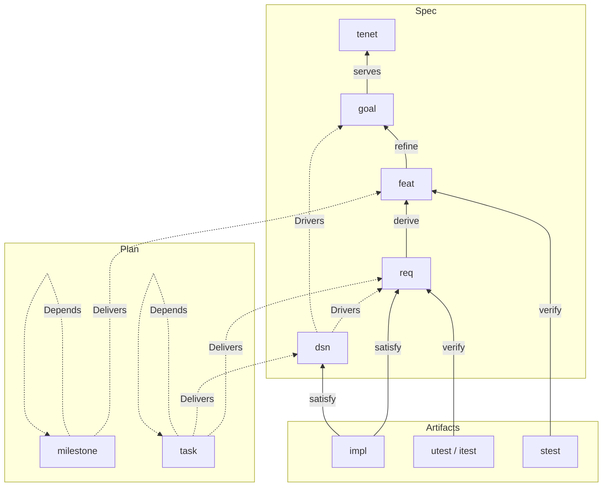
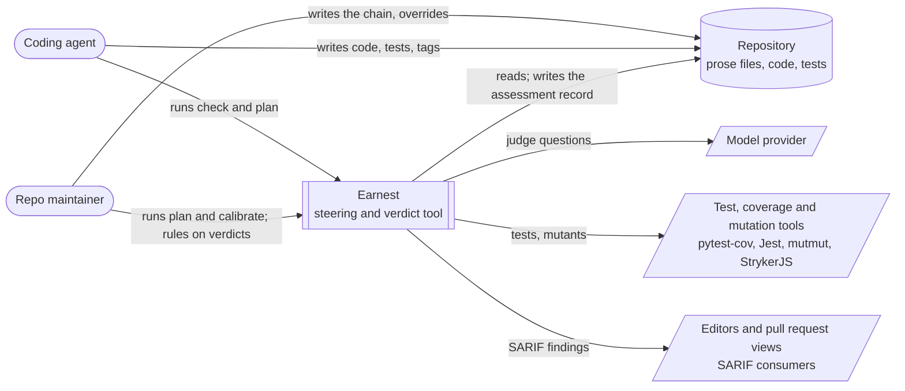
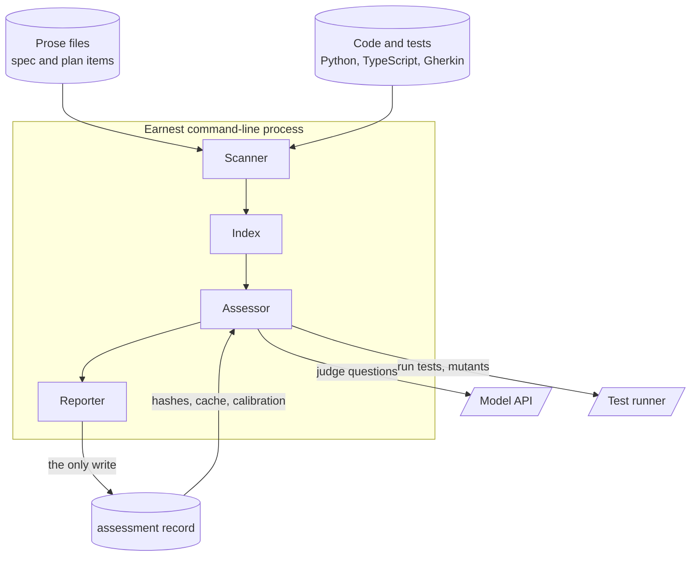
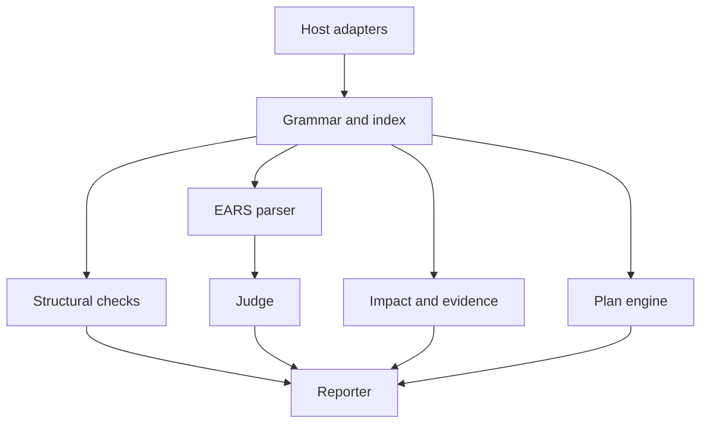
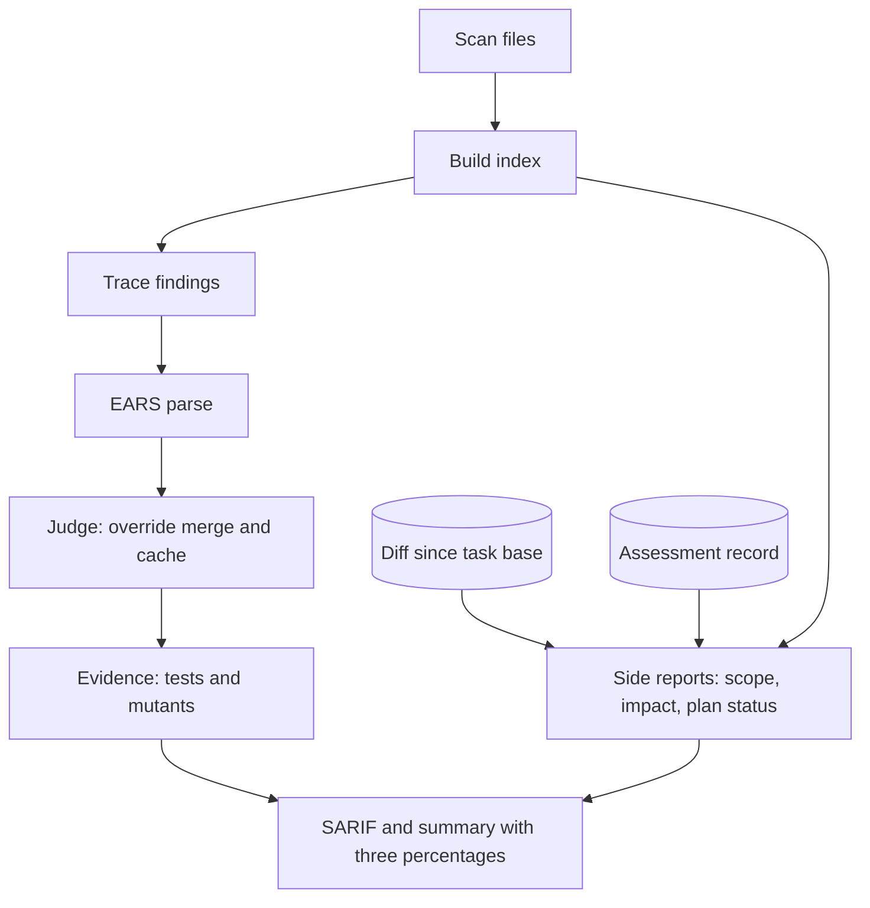

# 01 — Logic Design

Status: draft, derived from `00-project-intent.md`, September 2026.

## Context and problem

Requirement tracing tools check that a link exists. OpenFastTrace (OFT) reads a
coverage tag in a comment, finds the matching item in a Markdown spec, and
reports the requirement as covered. StrictDoc, sphinx-needs and LOBSTER do the
same with different syntax. That model worked while people wrote the tags,
because a person typing a tag usually meant it. Coding agents produce
well-formed, correctly revisioned tags at scale on code that only loosely
relates to the requirement, so a coverage report can read 100% while nobody can
tell how far "traced" has drifted from "done". A tag with nothing behind it is
hearsay.

Earnest is a steering tool for that situation. Humans own intent, goals,
features, requirements and decisions; agents implement, and run Earnest on
demand, from an editor or an agent session, to see where their work drifted
from the chain and from their current task. For every requirement Earnest
answers in three layers of rising cost and confidence: traced (the tags
resolve), judged (a model, asked narrow questions, agrees the code and tests
match the clause), and evidenced (the tagged tests pass and kill mutants of the
tagged code).

This document follows the fixed high-level design shape in
[[hld-documents-separate-solution-intent-from-implementation-detail-via-a-fixed-7]]:
`00-project-intent.md` holds intent (tenets T1–T7 and success criteria
SC1–SC10), and this document decides mechanism: the domain model, the grammar,
the key decisions, the logical architecture, the interfaces and the runtime
model. File and module layout belongs to `02-structural-design.md`.

## Goals

- **G1** Trace the whole chain from tenet to test on OFT's item model, keeping OFT's ID syntax, coverage semantics and link-status names as the reference. (T2, T7; SC1, SC2)
- **G2** Parse every `req` body as one of the five EARS forms so each requirement reads as prose and still yields a structure. (T1, T6; SC1, SC5)
- **G3** Report every requirement at exactly one level (untraced, traced, judged, evidenced) with located reasons and three separate percentages. (T4, T5; SC1, SC7)
- **G4** Model plan items (milestones and tasks) whose done-status is recomputed on every run from the levels of what they deliver, never typed. (T7; SC10)
- **G5** Check each change against the current task and turn anything outside it into a finding with exactly three exits. (T4, T7; SC8)
- **G6** Name the features a change impacts and the tests worth running, without running the full suite. (T4, T6; SC9)
- **G7** Build one index that the check and the judge share, so both report the same graph. (T6; SC5)
- **G8** Keep judge overrides in the prose files next to the item they override, keyed by id, revision and commit, so they expire with the revision and flag drift in the code. (T1, T5; SC4)
- **G9** Emit findings as SARIF plus a human summary, so one command's output tells an agent every change it needs. (T3, T4; SC2, SC3)
- **G10** Gate the judge on calibration against a maintainer's hand verdicts before the first milestone executes. (T5, T6; SC6)

## Actors and use cases

Two actors use Earnest. The **coding agent** implements work, tags code and
tests, and runs Earnest to learn what to fix before it claims a task is done.
The **repo maintainer** writes and revises the chain, rules on judge verdicts,
and reads the plan. Either can run any command; the use cases name who
typically does.

### UC1 Write the chain

- Actor: repo maintainer.
- Trigger: a new capability is wanted.
- Outcome: Markdown items exist for the goal, the features that refine it, the
  EARS requirements derived from each feature, and the `dsn` decisions that
  shape them; `earnest check` reports each parent without children as a gap.

### UC2 Tag and check before claiming done

- Actor: coding agent.
- Trigger: the agent believes its implementation is complete.
- Outcome: the agent has tagged code and tests, run `earnest check`, and
  received every gap, near-miss and weak verdict with file and line; it fixes
  them or reports them before claiming done.

### UC3 Check a change against the current task

- Actor: coding agent.
- Trigger: the agent is about to commit on a task branch.
- Outcome: every changed region outside what the task delivers is a finding
  offering exactly three exits: tag it under a requirement the task delivers,
  propose a task, or declare it blocked.

### UC4 Bump a revision

- Actor: repo maintainer.
- Trigger: a requirement's meaning changes.
- Outcome: the maintainer edits the item and bumps its revision; every tag or
  edge at the old revision becomes an outdated finding, and that list is the
  agent's work list; overrides at the old revision expire.

### UC5 Override a judge verdict

- Actor: repo maintainer.
- Trigger: the maintainer disagrees with a judge verdict.
- Outcome: an `Override:` line under the item records the maintainer's verdict,
  the commit it was made at and the reason, for that revision; the next check
  reports the override as the observation of record.

### UC6 Ask what a change impacts

- Actor: coding agent or repo maintainer.
- Trigger: a diff exists and the full suite is slow.
- Outcome: `earnest check` names the impacted requirements and features and
  the tests worth running, falling back to a conservative, flagged answer when
  a changed line has no coverage data.

### UC7 Ask the plan for status

- Actor: coding agent or repo maintainer.
- Trigger: someone wants the next milestone and what remains in it.
- Outcome: `earnest plan` prints the milestone and task graph with each item's
  computed status and the plan findings.

### UC8 Run the calibration gate

- Actor: repo maintainer.
- Trigger: before the first milestone executes, and whenever the judge model or
  prompt changes.
- Outcome: the maintainer runs `earnest calibrate` against a fixture; the judge
  runs over ten hand-tagged requirements, its verdicts are compared with the
  maintainer's, and the gate passes at eight or more matches (SC6).

## Capabilities

Each capability satisfies named success criteria and surfaces in the output of
one command, `earnest check`.

| Capability | SC it satisfies | Where `earnest check` shows it |
| --- | --- | --- |
| Trace | SC1, SC2, SC5 | trace findings and the traced percentage, on every run |
| Judge | SC1, SC4, SC6 | judge findings and the judged percentage, with `--judge` |
| Evidence | SC1, SC7 | evidence findings and the evidenced percentage, with `--evidence` |
| Scope check | SC8 | out-of-task findings, when a current task is known |
| Impact | SC9 | the impact section, when a diff exists |
| Plan status | SC10 | the plan status section and plan findings, also printed by `earnest plan` |
| Report | SC3, SC7 | SARIF plus a summary that leads with three percentages |

## Domain model

### Item groups

The item types fall into three groups, and every type belongs to exactly one.

- **Spec**: `tenet`, `goal`, `feat`, `req`, `dsn`. The repo maintainer
  authors these in prose files, and every change to a spec item is a human
  decision. The spec says what must be true and why. `00-project-intent.md`
  calls the narrower, requirement-only part of it "the requirement set".
- **Plan**: `milestone`, `task`. These also live in prose files. The plan says
  in what order the spec gets delivered.
- **Artifacts**: `impl`, `utest`, `itest`, `stest`. These are tags in code and
  test files, written by whoever writes the code, usually the coding agent.
  Artifacts claim to satisfy or verify spec items.

Throughout this document, "spec" means the first group, "the plan" the second,
and "prose files" the Markdown files that hold both spec and plan items.

### Item types

| Type | Source standard | Body rule (what the scanner checks) | Edges it carries | Checked by |
| --- | --- | --- | --- | --- |
| `tenet` | spec-kit constitution / SysML concern | — | none; the root of the spec | trace, as the root |
| `goal` | spec-kit success criterion / SysML top-level requirement | — | `Covers:` `tenet` (serves) | trace |
| `feat` | OFT `feat`; Cockburn use-case form by convention | — | `Covers:` `goal` (refine) | trace |
| `req` | EARS + OFT `req` | body parses as one of the five EARS forms | `Covers:` `feat` (derive) | trace, judge |
| `dsn` | OFT `dsn`; MADR body by convention | — | `Drivers:` `req` or `goal` | trace |
| `impl` | OFT | tagged code region | `Covers:` `req` or `dsn` (satisfy) | trace, judge, evidence |
| `utest` / `itest` | OFT test types | tagged test | `Covers:` `req` (verify) | trace, judge, evidence |
| `stest` | OFT test type; a Gherkin scenario | tagged scenario | `Covers:` `feat` (verify) | trace, evidence |
| `milestone` | PM vocabulary, spec-kit tasks file | — | `Delivers:` `feat`; `Depends:` `milestone` | plan status |
| `task` | PM vocabulary, spec-kit tasks file | — | `Delivers:` `req` or `dsn`; `Depends:` `task` | plan status |

Only `req` has a body rule. The use-case form for `feat` and the MADR sections
for `dsn` are writing conventions the scanner leaves unchecked. Only `tenet`,
`goal`, `milestone` and `task` are additions to what OFT ships. OFT treats
artifact types as free-form strings and reads the new key lines as prose, so
the prose files stay readable by OFT.

### Edges

Four keys carry edges.

- **`Covers:`** is OFT's, with OFT's meaning: the child claims to serve,
  refine, derive from, satisfy or verify the parent. A cover counts toward
  coverage only when the parent needs the child's type; OFT reports any other
  cover as `COVERED_UNWANTED`. That is why decisions use `Drivers:` in place of
  `Covers:`.
- **`Drivers:`** runs from a `dsn` to the `req` or `goal` ids that drive it.
  OFT reads it as prose, and it never counts toward coverage.
- **`Delivers:`** runs from a `task` to a `req` or `dsn`, and from a
  `milestone` to a `feat`. It never counts toward coverage.
- **`Depends:`** runs from a `task` to a `task`, and from a `milestone` to a
  `milestone`. Which tasks a milestone groups is computed through `Delivers:`
  and `Covers:`, so a milestone never names a task.



Solid arrows are `Covers:` and count toward coverage; dotted arrows are
`Drivers:`, `Delivers:` and `Depends:` and never count toward coverage. `tenet`
is the root of the spec: a tenet with no goal serving it is a gap, and a goal
serving no tenet is orphaned.

### Default Needs

When an item has no `Needs:` line, its type's default applies; an explicit
`Needs:` line wins. Test tiers attach to the spec, never to the plan.

| Type | Default `Needs:` |
| --- | --- |
| `tenet` | `goal` |
| `goal` | `feat` |
| `feat` | `req`, `stest` |
| `req` | `impl` plus its declared test tier, `utest` by default |
| `dsn` | `impl` |

A cover by a tier the requirement never declared is reported as unwanted, and
the declared tier stays a gap until a cover of that tier exists.

### Findings

Every finding has a rule id, a level and a location. The first five reuse OFT's
link-status names; the rest are Earnest's.

| Rule id | Level | Meaning |
| --- | --- | --- |
| `earnest/outdated` | error | a tag or edge names an older revision of an existing item; the message names the current revision |
| `earnest/predated` | error | a tag or edge names a revision above the item's current one |
| `earnest/unwanted` | warning | a cover by a type the parent never needs, so it counts toward nothing |
| `earnest/orphaned` | error | a tag or edge names an id absent from the index, or an item covers no parent; the message suggests the closest existing id |
| `earnest/duplicate` | error | two items share an id, or two `Override:` lines share an id and kind |
| `earnest/near-miss` | error | text nearly matches a tag surface; the message gives the canned fix |
| `earnest/req-not-ears` | error | a `req` body fails the EARS grammar; the message lists the five templates |
| `earnest/gap` | error | an item lacks a child its `Needs:` requires |
| `earnest/unplanned` | warning | a `req` is delivered by no task |
| `earnest/cycle` | error | the plan's dependency graph has a cycle |
| `earnest/out-of-task` | warning | a changed region lies outside what the current task delivers; the message offers the three exits |
| `earnest/override-expired` | warning | an `Override:` line names a revision other than the item's current one |
| `earnest/override-drift` | warning | the region an override covers changed since the override's commit; the judge reruns and both verdicts show |
| `earnest/unbumped-change` | error | an item body changed while its revision stayed the same |
| `earnest/impact-degraded` | note | a changed line has no coverage data, so impact selected a conservative set |
| `earnest/judge-uncalibrated` | warning | the judge ran with no passing calibration for the current model and prompt |
| `earnest/judge-not-satisfied` | warning | the judge answered a question with not-satisfied |
| `earnest/evidence-failed` | error | a tagged test fails, or a mutant inside a tagged region survives |

### Levels

A requirement's level is one field with four values, in order:

- **untraced**: some needed cover is missing or fails to resolve.
- **traced**: every needed cover resolves at the current revision.
- **judged**: traced, and every judge question is satisfied or overridden.
- **evidenced**: judged, and the tagged tests pass with no surviving mutant in
  the requirement's regions.

### Computed status

Status is recomputed from the graph on every run.

| Item | Done when |
| --- | --- |
| `task` | every `Delivers:` id resolves at its current revision, each delivered `req` is at level evidenced, and each delivered `dsn` is traced (an `impl` covers it) |
| `milestone` | every milestone it depends on is done, every `feat` it delivers has its `stest` green, and every `req` deriving from those features is delivered by a done task |

### Process vocabulary

The vocabulary for one run of Earnest comes from OSCAL's assessment model.
Tests already "verify" in the edge vocabulary, so the process avoids that word,
and it avoids "control", which implies a compliance catalogue.

| Term | Meaning |
| --- | --- |
| assessment | one run over the repository at a commit |
| observation | what one check saw about one edge for one question: method (`trace`, `inspection`, `test`), subject, result, reasoning, location |
| finding | a located result with a rule id and level, rolled up from observations |
| override | a human-authored observation that replaces the judge's for one item, revision and kind |

SARIF is the findings contract: every finding and the observations behind it
travel in the SARIF output. The one thing Earnest writes is the assessment
record, and it holds five things:

1. the run header: commit, timestamp, layers run, model id and prompt hash;
2. the body hash of every item, keyed by id and revision;
3. the commit the coverage map was taken at;
4. the judge cache;
5. the latest calibration result.

The judge cache key is the item's id and revision, the question, the hash of
the covered regions, the hash of the covering tests, the model id and the
prompt hash. A hit reuses the observation; any change in the key reruns the
question.

### Override rule

An override is an `Override:` line under the item, naming the item's id and
revision, a kind, the commit it was made at, and a reason.

- `implemented` replaces the judge's inspection observations on `impl` edges;
  `tested` replaces them on test edges.
- A revision other than the item's current one raises `override-expired`, and
  the override drops out of the verdict.
- Two overrides with the same id and kind raise `duplicate`.
- When a region the override covers changed since its commit, the override
  raises `override-drift`, the judge reruns, and the report shows both verdicts.

### Revision lifecycle

Change flows top-down, and Git holds the history while the revision carries the
semantic version.

1. A spec item's body changes, and the maintainer bumps its revision in the
   same change. Edits to key lines alone need no bump.
2. A body that changed at the same revision, detected because its hash differs
   from the one in the assessment record, raises `unbumped-change`.
3. Staleness propagates exactly one edge: bumping X makes every tag, `Covers:`
   and `Delivers:` that names X at the old revision `outdated`, located at that
   line.
4. Edges in the prose files resolve exactly as tags do. A missing id is
   `orphaned`, and a task with an unresolved `Delivers:` is never done.
5. The agent updates code and tests and re-tags at the new revision; the judge
   reruns for the item.
6. Overrides at the old revision expire.
7. A superseded decision is a revision bump of its `dsn`, with a prose line
   naming what it supersedes. Bumping a `tenet` or `goal` behaves like any other
   bump.

### Region rule

A tag governs the lines from itself to the next tag in the same file, or to the
end of the file. Consecutive tags with no code between them share the region
that follows them. Repeated tags for one id govern the union of their regions.
The scanner derives regions on every run, so nobody maintains them by hand.

### Scope rule

The current task comes from `--task`, or else from a branch named
`task/<name>-…`. The scope check reads the diff since the task's base commit
and matches each changed region's tags to the task's `Delivers:` ids on type and
name, ignoring revision. A region already reported `outdated` raises no
`out-of-task` finding. Every other changed region outside the task's items is
`out-of-task`, offering exactly three exits:

- tag it under a requirement the task delivers;
- propose a task, as a new task item in the diff, which is a plan change for
  the maintainer to ratify;
- declare it blocked, as a message to the maintainer rather than an item.

### Impact rule

Impact reads dynamic per-test coverage contexts: pytest-cov with
`--cov-context=test`, and Jest with `--findRelatedTests`. The coverage map is
taken at commit A; for a diff from A to B, unchanged lines are remapped through
`git diff A..B`. A changed or new line selects every test tagged to a
requirement whose region contains it; when no such requirement exists, impact
selects the full suite and raises `impact-degraded`. The output names the
impacted requirements, the features they derive from, and the tests worth
running.

### Evidence rule

The evidence layer runs mutmut for Python and StrykerJS for TypeScript on the
files that hold tagged regions, and leaves test selection to those tools. A
failing tagged test, or a surviving mutant inside a tagged region, raises
`evidence-failed` against every requirement that region's tags cover.

### Invariants

- Every spec item traces to a parent, except a `tenet`.
- Every parent has the children it needs, or it is a gap.
- Done is computed from the graph and evidence.
- Overrides carry id, revision and commit.
- Structural findings are model-free.

## Grammar

The grammar comes first, because the check and the judge read the same index
built from it. The index is consumable by an editor language server.

```ebnf
(* Identity *)
id          = type "~" name "~" revision ;
type        = lower , { lower } ;                     (* [a-z]+ *)
name        = namechar , { namechar } ;               (* [a-z0-9-]+ *)
namechar    = lower | digit | "-" ;
revision    = nonzero , { digit } ;                   (* positive integer *)
commit      = hexchar , { hexchar } ;                 (* git short sha *)
hexchar     = digit | "a" | "b" | "c" | "d" | "e" | "f" ;

(* Markdown item block *)
item        = id_line , body , { key_line } ;
id_line     = ( "`" id "`" | heading_marks " " "`" id "`" ) , newline ;
heading_marks = "#" , { "#" } ;
body        = prose_line , { prose_line } ;
key_line    = key , ":" , " " , value , newline ;
key         = "Needs" | "Covers" | "Drivers" | "Delivers" | "Depends"
            | "Override" ;
value       = id_list | override | type_list ;
id_list     = id , { "," , " " , id } ;               (* Covers, Drivers, Delivers, Depends *)
type_list   = type , { "," , " " , type } ;           (* Needs *)

(* Override line *)
override    = id , " " , ( "implemented" | "tested" ) , " at " , commit , "," , reason ;

(* Comment tag surface: Python "#" and TypeScript "//" or block comments *)
comment_tag = "[" , type , "->" , id , "]" ;

(* Gherkin tag surface: brackets are illegal in Gherkin tags *)
gherkin_tag = "@" , type , ":" , id ;

(* EARS: fixed keyword order, every clause optional except the core *)
ears        = [ "Where" , feature , "," ]
              [ "While" , state , "," ]
              [ "When" , trigger , "," | "If" , condition , "," , "then" ]
              "the" , system , "shall" , response , "." ;
```

The five EARS forms fall out of which optional clauses are present:
ubiquitous (none), event-driven (`When`), state-driven (`While`), unwanted
behavior (`If ... then`), and optional feature (`Where`). Complex requirements
combine them in the fixed order the grammar shows. The parse records each
clause's text span, and those spans are what the judge asks about.

### Near-miss

A near-miss is any text matching a loose superset of the tag surfaces (a
bracketed or `@`-prefixed token with a `~` inside) that fails the strict
grammar. The scanner checks it against a fixed table of patterns and reports it
with file, line and the pattern's canned fix. OFT and similar tools read these
as ordinary comments, so the coverage they intended silently disappears.

| Pattern | Example | Canned fix |
| --- | --- | --- |
| missing `>` | `[impl-req~x~1]` | write `->` between the artifact type and the id |
| missing revision | `[impl->req~x]` | append `~` and the item's current revision |
| uppercase name | `@stest:feat~Login~1` | lower-case the name |
| `@` tag without `:` | `@stest feat~login~1` | put `:` between the artifact type and the id |

## Key design decisions

### D1 Reimplement the tag scan, file-format compatible with OFT

- Decision: Earnest scans tags and items itself, reading and writing the same
  file formats OFT does. The default `Needs:` per type is Earnest's, so full
  parity with OFT's own report needs explicit `Needs:` lines.
- Alternatives considered: shell out to OFT's Java trace and consume its
  output.
- Rationale: T2 keeps OFT the reference for syntax and coverage, which file
  compatibility preserves. T3 and T6 favor one dependency-free command whose
  structural answers are deterministic. OFT's trace cannot see goals, tasks or
  near-misses, so Earnest would need its own scan for those anyway.

### D2 Non-EARS requirement bodies are errors listing the five templates

- Decision: a `req` whose body fails the EARS grammar raises
  `earnest/req-not-ears`, an error whose message lists the five templates:
  "The system shall response.", "When trigger, the system shall response.",
  "While state, the system shall response.", "If condition, then the system
  shall response." and "Where feature, the system shall response."
- Alternatives considered: warn only; accept and judge with less structure;
  guess the nearest form.
- Rationale: T6. Judge questions are generated from the parse, so an unparsed
  requirement can be traced but never judged. An error makes that visible
  instead of letting the judged percentage quietly shrink, and listing all five
  templates gives the agent the fix without a guess (T4).

### D3 Overrides are lines in the spec, keyed by id, revision and commit

- Decision: an override is an `Override:` line under the item naming the id
  and revision, a kind, the commit it was made at, and a reason. A revision
  other than the item's current one expires it; a change to the covered region
  since its commit flags drift, per the Override rule in the Domain model.
- Alternatives considered: a sidecar file next to the prose files; entries in
  the assessment record; id and revision alone, without a commit.
- Rationale: T1 keeps everything a human rules on in the prose files; T5 wants
  overrides visible in the diff next to the requirement they change. The commit
  lets an override stand while the code under it holds still, and surface the
  moment that code moves.

### D4 Evidence through mutmut and StrykerJS on tagged files

- Decision: mutmut and StrykerJS mutate the files that hold tagged regions and
  select the tests themselves; a surviving mutant inside a tagged region raises
  `evidence-failed`.
- Alternatives considered: Earnest's own mutation runner with per-region test
  selection; mutation per file, reported against every requirement in it.
- Rationale: the tagged region is the unit a requirement claims, so a mutant
  that survives there is the evidence that matters (T7). Existing tools already
  generate mutants and select tests well, so Earnest only filters their results
  by region (T3).

### D5 The grammar and index serve an editor language server

- Decision: the grammar and the index are complete enough for an editor
  language server to consume the same index the check builds.
- Alternatives considered: rely on OFT's Java language server.
- Rationale: OFT's server knows nothing of goals, EARS, near-misses or
  findings, and SARIF already carries findings into editors and pull request views
  (T3).

### D6 Process vocabulary from OSCAL; SARIF as the contract; one record

- Decision: assessment, observation, finding and override, as defined in the
  Domain model section. SARIF is the only findings contract, and the assessment
  record is the only thing Earnest writes.
- Alternatives considered: SysML "verification case" and "verdict";
  compliance "control" and "evidence"; bespoke schemas for items, edges and
  observations beside SARIF.
- Rationale: OSCAL separates what was observed from the verdict drawn from it,
  which matches the judge showing its work (T5). One contract and one record
  leave consumers nothing to reconcile (T6).

### D7 One feature level, in use-case form

- Decision: `feat` is the only feature type, written as a Cockburn use case by
  convention; the actor is a field in the prose, and the scanner leaves the
  form unchecked.
- Alternatives considered: a separate `uc` type; actors as first-class items;
  a checked use-case body.
- Rationale: tracing actors yields no useful finding, and a second feature
  level doubles the chain an agent must satisfy without adding a check (T4).
  Only structure the judge reads earns a body rule (T6).

### D8 Decisions are `dsn` items with a `Drivers:` key

- Decision: architectural decisions are OFT `dsn` items, with a MADR body by
  convention and a `Drivers:` line naming the requirements or goals that drive
  them. A task may deliver a `dsn`. Supersession is a revision bump.
- Alternatives considered: a standalone ADR folder outside the trace; a new
  item per superseding decision.
- Rationale: T2 keeps decisions in OFT's model so code can cover them, and a
  refactor delivering a `dsn` gets a place in the plan (T7). A revision bump
  reuses the lifecycle every other item already follows.

### D9 Test tiers declared in `Needs:`; two plan levels

- Decision: `Needs:` on each requirement declares its test tier, and a missing
  cover of that tier is a gap. The plan has milestones and tasks only, and a
  milestone depends only on milestones.
- Alternatives considered: three plan levels mirroring the three test tiers;
  milestones depending on tasks.
- Rationale: the tier is a property of the behavior, so it belongs on the
  requirement and is checked like any other need (T6). Two plan levels are
  enough to compute done (T7); deriving a milestone's tasks through
  `Delivers:` keeps one source for that grouping.

### D10 Region rule: tag to next tag or end of file

- Decision: regions are derived by the Region rule in the Domain model:
  stacked tags share the region that follows them, and repeated tags for one id
  union their regions.
- Alternatives considered: tree-sitter regions scoped to the enclosing
  definition; explicit end-of-region markers, which add another thing to
  maintain by hand.
- Rationale: the rule works identically in every language with comments (T3),
  is deterministic (T6), and needs no host-language parser.

### D11 Scope check on the diff since the task's base commit

- Decision: the scope check reads the diff from the task's base commit, takes
  the current task from `--task` or the branch convention `task/<name>-…`,
  matches tags to the task's items ignoring revision, and lets `outdated`
  suppress `out-of-task` for the same region.
- Alternatives considered: a state file naming the current task; a required
  command-line flag; matching on the full id with revision.
- Rationale: branch names already exist in every workflow and agents already
  create them (T3, T4). Ignoring revision keeps one change from raising two
  findings, and the outdated finding already names the fix.

### D12 Impact from dynamic coverage, with a degraded fallback

- Decision: impact uses per-test coverage contexts only, remaps unchanged lines
  through the diff since the map's commit, and falls back to every test tagged
  under the changed region's requirements, or the full suite with
  `impact-degraded`, for lines the map never saw.
- Alternatives considered: a static call graph, alone or in union with
  coverage; hand-annotated critical paths, which add another thing to keep in
  sync by hand.
- Rationale: dynamic contexts are exact for what the tests execute and cost
  only a coverage run (T6). The fallback over-selects rather than under-selects,
  and says so.

### D13 Findings as SARIF plus a human summary

- Decision: all findings are emitted as SARIF 2.1.0 with a human summary.
- Alternatives considered: a bespoke JSON format.
- Rationale: SARIF is already read by editors, code scanning and PR views, so
  findings reach agents and humans with no Earnest integration (T3, T4).

### D14 The EARS parse drives the judge

- Decision: judge questions are generated from the precondition, trigger and
  response spans of the parse; the model answers them and never chooses what
  to ask. The judge's questions come from the EARS parse alone; tenets
  constrain the graph structurally.
- Alternatives considered: a free-form "is this implemented?" prompt; every
  tenet in every prompt.
- Rationale: T6 confines the model to reading comprehension, and fixed
  questions make verdicts comparable across runs and calibratable (SC6). A
  shorter prompt keeps calibration about the clause alone.

### D15 Provenance through a body hash per revision

- Decision: the assessment record keeps the body hash of each item at each
  revision, and a body that changes at the same revision raises
  `unbumped-change`.
- Alternatives considered: git blame on the prose files; a human-only accept
  step for agent-created spec and plan items.
- Rationale: a hash catches the silent edit that would let code and item drift
  apart at one revision, with no reader (T6, T7). An accept step would move
  Earnest from reporting to gating, and Open questions holds that choice.

### D16 Trace findings reuse OFT's link-status names

- Decision: trace findings are named outdated, predated, unwanted, orphaned and
  duplicate, after OFT's link statuses.
- Alternatives considered: names of Earnest's own.
- Rationale: T2 keeps OFT the reference, and a reader who knows OFT reads the
  findings without a glossary.

### D17 Decisions link through `Drivers:`

- Decision: a `dsn` names what drives it on a `Drivers:` line, which never
  counts toward coverage.
- Alternatives considered: `Covers:` from the `dsn` to its drivers.
- Rationale: a `req` or `goal` never needs a `dsn`, so OFT reports such a cover
  as `COVERED_UNWANTED`, verified in OFT's `LinkStatus` source. A separate key
  keeps OFT's report clean (T2).

## Architecture (C4 model)

The architecture is described at the first three levels of the C4 model
([[c4-model-describes-systems-at-four-abstraction-levels-context-containers]]):
context, container and component. The code level belongs to
`02-structural-design.md`.

### Context



### Container

A single command-line process is the only runtime container Earnest owns.
Everything else is the repository's content or an external system.



### Component



Host adapters know only how to find comments, headings and Gherkin tags in
their language; the grammar alone decides what parses. Everything downstream of
the index is language-agnostic, so adding a language means adding one adapter.

## Runtime data flow



Each layer runs only when requested and only over what the layers before it
passed: the judge reads only items that reach traced, and the evidence layer
reads only items that reach judged, so `--evidence` implies `--judge`. Scope,
impact and plan status are side reports computed from the index plus the diff
and the record. The check and the judge read one index, so they cannot
disagree about the graph.

## Interfaces and data contracts

### Command surface

| Command | Output |
| --- | --- |
| `earnest check [--task <id>] [--judge] [--evidence]` | SARIF plus a summary: findings, each requirement's level, and three percentages (traced, judged implemented, evidenced); scope findings when a current task is known; the impact section when a diff exists; plan status. Trace runs by default. |
| `earnest plan` | the milestone and task graph with each item's computed status, plus plan findings; read-only |
| `earnest calibrate <fixture>` | the judge's verdicts on the fixture beside the maintainer's, the match count and pass or fail against SC6; writes the result to the assessment record |

The exit code is non-zero only when an error-level finding exists, so the same
command gates a pre-commit hook, a CI job or an agent's "done" claim. While the
record holds no passing calibration for the current model id and prompt hash,
every judge run raises `judge-uncalibrated`.

### SARIF 2.1.0

SARIF is the only findings contract.

- Each finding is one SARIF `result` with `ruleId`, `level`, `message` and a
  `physicalLocation`. The rule ids and levels are exactly those in the Findings
  subsection of the Domain model.
- The observations behind a finding travel under the result's `properties`.
- The commit, the model id, the prompt hash and the layers run travel under the
  run's `invocations` and provenance properties.

### Assessment record

The record holds the five things listed under Process vocabulary: the run
header, the body hash per id and revision, the coverage-map commit, the judge
cache and the calibration result.

### Prose item example

```markdown
`req~login-rate-limit~2`

When a client exceeds five failed logins in one minute, the auth service shall
reject further attempts for fifteen minutes.

Needs: impl, utest
Covers: feat~sign-in~1
Override: req~login-rate-limit~2 implemented at 3f9c2a1, lockout lives in the gateway config
```

### Reference resolution

A tag's or edge's target id resolves by exact match on type and name against
the index. Then the revision decides the class:

- Type, name and revision match: the edge resolves.
- Revision below the item's current one: `earnest/outdated`, located at the
  tag, naming the current revision.
- Revision above the item's current one: `earnest/predated`.
- No item with that type and name: `earnest/orphaned`, with the closest
  existing id suggested when one is within a small edit distance.

## Runtime and permission model

Earnest reads the repository and writes one thing: the assessment record, kept
in the repository next to the requirement set. `earnest calibrate` also writes
to it. Every fix to the prose files and the code is the agent's or the
maintainer's to make.

The evidence layer executes the repository's own tests, and executes them
against mutated copies of the tagged code. Running `earnest check --evidence`
therefore carries the same trust as running the test suite.

The judge layer sends the model provider only the requirement clause, the
tagged code regions and the tagged tests, and only when the judge layer is
requested. The trace layer, the scope check, impact and plan status run
entirely on the local repository.

## Open questions

| Question | Owner | Resolved by |
| --- | --- | --- |
| A human-only accept step to ratify agent-created spec and plan items | maintainer | before the implementation plan |
| Whether the judge applies tenets to observations | maintainer | after the calibration gate reports |
| Judge model choice and prompt | maintainer | the calibration gate |
| SC6 calibration gate | maintainer | unrun; a precondition to the first milestone |

## Scope

- The taxonomy in the Domain model section: `tenet`, `goal`, `feat`, `req`,
  `dsn`, `impl`, `utest`, `itest`, `stest`, `milestone`, `task`.
- Markdown, Python, TypeScript and Gherkin host adapters.
- The trace, judge and evidence layers, with evidence through mutmut and
  StrykerJS.
- The scope check against the current task, inside `earnest check`.
- Impact through dynamic per-test coverage, with a degraded fallback.
- Computed plan status and the plan findings.
- SARIF output with a human summary.
- Overrides in the spec, keyed by id, revision and commit.
- Provenance through a body hash per revision.
- The calibration command.
