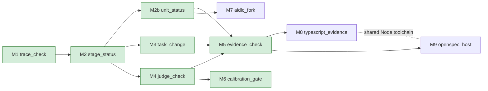

# 03 — Implementation Plan

Status: draft, derived from `02-structural-design.md`, September 2026.

This document orders the build of the `earnest` package that
`02-structural-design.md` lays out, as a graph of milestones in the shape of
[[structure-implementation-plans-as-sequential-foundation-then-parallel-branches]]:
a sequential foundation that freezes the contracts the rest reads, then
branches that run in parallel once it holds. The `iterative-build-loop` skill
executes it one milestone per loop, with context cleared between loops, so each
milestone names everything a fresh session loads.

## Milestone DAG

M1 and M2 are the foundation. M1 fixes the index and the SARIF output that
every later milestone reads, and M2 adds the assessment record, the contract
that revision checks, the judge cache, the coverage-map commit, calibration and
the run header share. M2 also adds the Region rule, which M3 reads for
out-of-task and impact and M4 for the judge cache key and `override-drift`.
M3 and M4 then run in parallel, and M7 follows M2b. M2b adds per-unit stages,
units and team gates on routes with Units Generation; M5 and M7 wait on it,
because M5 shows a unit as done and M7 gates real intents of `classic`,
`enterprise`, `feature`, `mvp` and `workshop`. M5 joins M2b, M3 and M4:
evidence runs in `impact.py` beside impact, and `--evidence` implies `--judge`.
M6 continues the judge branch. Evidence has its own milestone so that M6 waits
on the judge alone, and the out-of-task check and impact have theirs so that M2
carries only the record, the stage engine and the Region rule. M8 follows M5
and adds TypeScript evidence through StrykerJS and Jest; it is part of v1.
M9 follows M5 too. It hosts OpenSpec as a second delivery method, ratified on 2026-11-25 through
#19, and stays outside v1. M8 and M9 depend on each other for
nothing but one Node toolchain (#36 and #26), which lands once, in whichever milestone
goes first.

M1 is the first runnable milestone, and no open question gates it or M2. The
rows of the Open questions sections that gate later milestones are named in
each milestone below. When a milestone's exit command runs green, its node
gains the `done` class, and the graph doubles as the loop's progress board.

## How a milestone runs

- Exit command: each milestone exits on one behavior feature,
  `tests/features/<slug>.feature`, bound by the pytest-bdd step module
  `tests/steps/test_<slug>.py`, as the Tests section and decision L5 of `02`
  fix. The exit command is `uv run pytest tests/steps/test_<slug>.py`, run in
  `packages/earnest/`; the milestone is done when it runs green.
- Scenarios: `04` writes each feature's scenarios before its code
  ([[write-gherkin-before-code-not-after]]).
- Task plans: task-level detail is written just in time, one plan per
  milestone, with the superpowers `writing-plans` skill when the milestone is
  next, at `docs/superpowers/plans/<date>-<slug-with-hyphens>.md`.
- Gating open questions: the rows of the Open questions sections of `01`, `02`
  and `04` that a milestone cannot exit without. Each closes by the resolution its
  row names.
- Goals: a milestone's goal and exit behavior hold for the whole loop, and
  change only through a revision of this document that the maintainer ratifies
  ([[goals-must-be-immutable-during-execution]]).

## Milestones

### M1 `trace_check`

- Goal: build the trace spine end to end over `broken-links`. It detects and
  reports orphaned and near-miss tags, and a finding that reaches no stage
  takes position `current`. The assessment record arrives with M2.
- Depends on: none.
- Exit behavior: two `earnest check` runs in `broken-links` give identical
  SARIF. The SARIF shows every seeded missing link, orphan, stale revision,
  malformed id and near-miss at file and line, each `req` at untraced or
  traced, the traced percentage, and a non-zero exit.
- Exit command: `uv run pytest tests/steps/test_trace_check.py`.
- Deliverable: `earnest check` through `cli.py`, `git.py`, the four
  `adapters/`, the grammar, index, Reference resolution and Near-miss table of
  `index.py` (the table validates `Override:` values too), the link rules of
  `structural.py`, and the SARIF output and
  summary of `reporter.py`; `tests/conftest.py`,
  `tests/fixtures/broken-links/`, `trace_check.feature` and its step module;
  the `earnest` script (L4), pytest-bdd and the fixture excludes (L5, L6).
- Spec coverage: UC1 and UC2 (links); SC1, SC2, SC3 (untraced and traced),
  SC10 (message text only); the Trace and Report capabilities.
- Context to load: `00`: Success criteria. `01`: Grammar, Near-miss, Item
  types, Edges, Default Needs, Findings, Trace levels, Frontier and position,
  Process vocabulary, Reference resolution, Command surface, SARIF 2.1.0,
  Runtime and permission model, D1, D13, D16. `02`: the
  File and directory tree; Package, Scanner, Index, `structural.py`, Reporter
  and Tests in Module boundaries; L4 to L6.
- Gating open questions: none.
- Task plan:
  [2026-09-26-trace-check.md](../superpowers/plans/2026-09-26-trace-check.md).

### M2 `stage_status`

- Goal: add the assessment record's writer, the route, approvals, frontier and
  position, computed status with `unplanned` and `cycle`, `earnest plan`,
  `--stage`, `unbumped-change` and outdated approvals.
- Depends on: M1.
- Exit behavior: in `seeded-change`, `earnest plan` prints the route, each
  stage's computed status, its approval and the frontier. `check --stage`
  prints the assessment hash and writes the run header. After the change
  commit, a check flags the tag, edge and approval left at the old revision,
  and a body edited without a bump. A route with `units-generation` is refused
  with exit 2; M2b replaces the refusal.
- Exit command: `uv run pytest tests/steps/test_stage_status.py`.
- Deliverable: the Region rule in `index.py`, with each item's body hash; the
  per-language code-line scan the Region rule needs in the comment adapters,
  `Source.code_lines` and `Source.digest`; `git.py` listing no path under
  `.earnest/` and reporting the changed paths; `plan.py` with the route,
  stages, approvals, frontier and position, computed status, the stale-approval
  note and the assessment document; the record's reader and writer in
  `reporter.py`, with the rule ids `earnest/unbumped-change`,
  `earnest/unplanned`, `earnest/cycle` and `earnest/route-mismatch` in `RULES`;
  the Revision lifecycle in `structural.py`, which also applies the route rule
  of Stages to the Default Needs and to parentless items; `earnest plan`,
  `--stage` and `--intent` in `cli.py`; the record-directory skips in
  `adapters/__init__.py`; `tests/fixtures/seeded-change/` with its `change/`
  overlay; `stage_status.feature` and its step module.
- Spec coverage: UC4, UC7, UC9 (engine); SC1, SC5, SC8 (stage and task
  status), SC9 (run header); the Revision propagation, Plan and stage status,
  and Stage approval capabilities.
- Context to load: `01`: Adopting AI-DLC, Stages, Findings, Frontier and
  position, Computed status, Process vocabulary, Revision lifecycle, Command surface,
  SARIF 2.1.0, Assessment record, Assessment hash, Runtime and permission model, Region rule,
  D6, D9, D10, D15. `02`: Scanner, Index, `git.py`, `plan.py`, `structural.py`,
  `reporter.py`, `conftest.py` and `fixtures/seeded-change/` in Module
  boundaries.
- Gating open questions: none.
- Task plan:
  [2026-10-10-stage-status.md](../superpowers/plans/2026-10-10-stage-status.md).

### M2b `unit_status`

- Goal: report per-unit stages, units and team gates on routes with Units
  Generation, from this repository alone.
- Depends on: M2.
- Exit behavior: in the future-format units variant of `seeded-change`,
  `earnest plan` prints each per-unit stage as
  `<phase>/<unit directory>/<slug>` with its computed status and approval, and
  each unit, in unit order, with its status, directory and frontier; an
  error at one unit's frontier fails the check whatever another unit's
  frontier; an unusable unit table fails the check and drops no need; `check --stage` for a per-unit stage
  prints the assessment hash and writes the run header; a gate row approves a
  unit's stage only through a `Unit` that the unit table joins to its
  directory, at the unit's latest `Attempt Generation`.
- Exit command: `uv run pytest tests/steps/test_unit_status.py`.
- Deliverable: in `plan.py` the unit table, per-unit stages, unit frontiers,
  unit-scoped gate rows and unit status; in `cli.py` per-unit `--stage` and no
  unsupported-route refusal; the unit lines in `reporter.py`; the `units/`
  overlay of `seeded-change`; `unit_status.feature` and its step module. The
  fork's per-unit work is M7's.
- Spec coverage: UC7, UC9 (per-unit approvals); SC1, SC8 (unit and per-unit
  stage status), SC9 (per-unit run header); the Plan and stage status
  capability.
- Context to load: `01`: Stages, Frontier and position, Per-unit stages and
  units, Computed status, Command surface. `02`: `plan.py`, `conftest.py`,
  `fixtures/seeded-change/`, L6.
- Gating open questions: none.
- Task plan:
  [2026-10-14-unit-status.md](../superpowers/plans/2026-10-14-unit-status.md).

### M3 `task_change`

- Goal: add the out-of-task check in `plan.py` and impact in `impact.py`.
- Depends on: M2.
- Exit behavior: with a current task and an approved stage check recorded,
  and no Git branch read, `earnest check` reports each changed region since
  that check that lies outside the task, with the three exits. It also prints an impact
  section of requirements, features and tests to run, with `impact-degraded`
  for a line that has no coverage data.
- Exit command: `uv run pytest tests/steps/test_task_change.py`.
- Deliverable: the Out-of-task rule in `plan.py`; the Impact rule in
  `impact.py`, over pytest-cov's per-test contexts; the `seeded-change` cases
  its feature reads; `task_change.feature` and its step module.
- Spec coverage: UC3, UC6; SC6, SC7; the Out-of-task check and Impact
  capabilities.
- Context to load: `01`: Out-of-task rule, Impact rule, Region rule, D11, D12.
  `02`: `git.py`, `index.py`, `plan.py`, `impact.py` and
  `fixtures/seeded-change/change/` in Module boundaries.
- Gating open questions: none left. The change baseline, the current task
  and the coverage map timing are settled in `01` (the Out-of-task and Impact
  rules), with no Git branch read; how M3's overlay changes meet M2's exact
  findings tables is settled in `04`.
- Task plan:
  [2026-10-20-task-change.md](../superpowers/plans/2026-10-20-task-change.md).

### M4 `judge_check`

- Goal: add the EARS parse, judge questions from its spans, the judge cache
  and the Override rule.
- Depends on: M2.
- Exit behavior: against a stub model, `check --judge` reports `req-not-ears`,
  a `judge-not-satisfied` verdict with reasoning and location,
  `judge-uncalibrated`, the judged percentage, and an override as the
  observation of record. After the change commit it reports `override-expired`
  and `override-drift`.
- Exit command: `uv run pytest tests/steps/test_judge_check.py`.
- Deliverable: `ears.py`; `judge/__init__.py` and `judge/prompt.txt` with the
  questions, the cache and the Override rule; `--judge` in `cli.py`; the
  `seeded-change` cases its feature reads; `judge_check.feature` and its step
  module.
- Spec coverage: UC2 (weak verdicts), UC5; SC3 (judged), SC4 (warning), SC11;
  the Judge and Overrides capabilities.
- Context to load: `01`: Grammar, Override rule, Process vocabulary,
  Region rule, D2, D3, D14. `02`: `ears.py` and `judge/` in Module boundaries;
  L4.
- Gating open questions: none left. The stub judge model is the
  canned-verdict file that `EARNEST_JUDGE` names, settled in `01` (Runtime
  and permission model). The judge model choice and prompt row of `01`
  settles at M6.
- Task plan:
  [2026-10-21-judge-check.md](../superpowers/plans/2026-10-21-judge-check.md).

### M5 `evidence_check`

- Goal: run the tagged tests and mutmut, with results filtered to tagged
  regions.
- Depends on: M2b, M3 and M4.
- Exit behavior: `check --evidence` raises `evidence-failed` for a surviving
  mutant in a tagged region, puts every requirement at exactly one of the four
  levels with three separate percentages, and shows the evidenced task and its
  unit as done.
- Exit command: `uv run pytest tests/steps/test_evidence_check.py`.
- Deliverable: the Evidence rule in `impact.py`, with the mutmut and StrykerJS
  report readers, the StrykerJS one covered by unit tests only; `--evidence` in
  `cli.py`; the
  record's `evidence` key in `reporter.py`; the evidenced raise reading it in `check` and
  `plan`, without running a test; the `seeded-change` cases its
  feature reads; `evidence_check.feature` and its step module.
- Spec coverage: SC3 (in full), SC8 (done); the Evidence capability.
- Context to load: `01`: Evidence rule, Trace levels, Computed status, D4,
  Assessment record, Frontier and position, Process vocabulary, Command
  surface, Runtime and permission model. `02`:
  `impact.py`, `reporter.py`, `plan.py`, `structural.py`, `cli.py` and
  `judge/__init__.py` in Module boundaries; L4.
- Gating open questions: none left. The evidence result is the record's
  `evidence` key, and the TypeScript evidence fixture moves to M8, both
  settled in `01` by the maintainer's decision of 2026-10-25 (E1 and E2 of
  the task plan).
- Task plan:
  [2026-10-25-evidence-check.md](../superpowers/plans/2026-10-25-evidence-check.md).

### M6 `calibration_gate`

- Goal: add `earnest calibrate` and the calibration fixture.
- Depends on: M4.
- Exit behavior: `earnest calibrate tests/fixtures/calibration` shows the
  judge's ten verdicts beside the maintainer's, the match count, and a pass at
  eight or more written to the record. After that, `--judge` stops raising
  `judge-uncalibrated`. The feature uses the stub model; the real-model run is
  the SC4 gate itself.
- Exit command: `uv run pytest tests/steps/test_calibration_gate.py`.
- Deliverable: `earnest calibrate` in `cli.py`; calibration in `judge/`;
  `tests/fixtures/calibration/`; `calibration_gate.feature` and its step
  module.
- Development fixture: the SYNTHETIC `tests/fixtures/calibration-dev/` (user
  decision 2026-10-27), agent-written and never used to claim SC4. The exit
  command and the demo run on it; `tests/fixtures/calibration/` waits for the
  maintainer's fixture, and the SC4 real-model run is unrun. Decided
  2026-11-25: the real run is approved; it uses no `ANTHROPIC_API_KEY`. The
  judge calls Claude through Claude Code (`claude -p`) on this host, where
  Claude Code authenticates to Amazon Bedrock, so the run bills the AWS account
  Claude Code is configured for. It goes through a new judge backend,
  `EARNEST_JUDGE=claude-code:<model>`, which spike G designed and Task 7b of the
  plan builds before the run; Task 7b's live one-call check comes before the
  20-call run. A passing `claude-code:` calibration satisfies SC4, and the
  calibration slot and the judge cache key record the `claude --version` output
  and a hash of the flags and system text, so a `claude` upgrade asks again.
  Calibrate keeps the answers already given when a call fails, so a rerun asks
  only the rest. The fixture pins apartment-twin `aff94e3`, an agent drafts its
  requirements, EARS rewrites and tags for the user to approve, and the user
  writes the twenty verdicts; the BDD gate stays on `calibration-dev`, and no
  paid `check --judge` runs.
- Spec coverage: UC8; SC4; the Calibration capability.
- Context to load: `00`: SC4. `01`: UC8, G10, Process vocabulary, Command
  surface. `02`: `judge/` and `fixtures/calibration/` in Module boundaries.
- Gating open questions: the file format of `tests/fixtures/calibration/`
  (`02`); calibration source repository, and judge model choice and prompt
  (`01`). All three were answered on 2026-10-25 (answer 2, the fixture source,
  revised to 3d-pipe on 2026-10-26) in the task plan; the judge model is the
  candidate the SC4 run tests.
- Task plan:
  [2026-10-25-calibration-gate.md](../superpowers/plans/2026-10-25-calibration-gate.md),
  its gating answers approved by the maintainer on 2026-10-25.
- Demo: [m6-calibrate.md](../demo/m6-calibrate.md), run by
  `docs/demo/m6-calibrate.sh` on the synthetic fixture.

### M7 `aidlc_fork`

- Goal: gate the AI-DLC fork from this repository. The fork applies the Fork
  delta of `02` under its own plan, in its own repository; this milestone is
  the integration gate.
- Depends on: M2b.
- Exit behavior: the feature runs against a local fork checkout with Bun on
  the PATH, and fails rather than skips if either is missing. The fork's
  sensor prints `{pass, findings_count}` with exit 0 for a `seeded-change`
  stage, with pass false while an error sits behind or current. Approve writes
  `GATE_APPROVED` with `Assessment Hash`, `Items` and `Approved By`.
  For a per-unit stage of the units variant the sensor passes
  `<phase>/<unit directory>/<slug>`, and approve writes `Unit` with them.
- Exit command: `uv run pytest tests/steps/test_aidlc_fork.py`.
- Deliverable: `aidlc_fork.feature` and its step module here; the Fork delta
  in the fork's repository, which must include the per-unit work M2b leaves to
  it: the sensor script deriving the unit directory from `output_path`, the
  three fields and `Unit` at the team gates' emit sites in `aidlc-state.ts` and
  `aidlc-unit.ts`, and `Unit` on the solo approve path.
- Spec coverage: UC9; SC9; the Stage approval capability; G13.
- Context to load: `01`: Adopting AI-DLC, including "The `earnest` sensor and
  the approval gate"; Command surface; Runtime and permission model. `02`: Fork
  delta; L3. The fork's own plan.
- Gating open questions: all seventeen DECIDED (user, 2026-11-25), in the
  task plan. Row 4 keeps `nullrul/aidlc-workflows` and revises L3 of `02`, which
  needs an upstream sync of the fork first (against the plan's recommendation of
  a standalone repository). The rows: from `01`, whether the gate or the approve transition
  refuses a run header with `dirty` true (neither refuses); the Fork-delta path that holds the
  gate presentation, and the path of the record the approve transition reads;
  and the Fork-delta path that holds the check on an artifact that changes
  during a sensor run. From `02`: the fork repository's name and owner; how the
  sensor script finds the `earnest` command; the upstream tools that
  read `source-manifest.json`; the upstream artifacts the mapping table leaves
  unnamed; the User Stories requirement ids; holding the sensor on through the
  sensors-off switches; the upstream tests that pin sensor ids and routes.
  From M2b: authority to create and push the fork repository, a fork checkout
  with Bun, and the per-unit row of `01`.
- Task plan: the integration gate at
  `docs/superpowers/plans/<date>-aidlc-fork.md`, written when M7 is next; the
  delta's plan lives in the fork's repository.

### M8 `typescript_evidence`

- Goal: evidence for TypeScript through StrykerJS and Jest, end to end, in v1.
- Depends on: M5.
- Exit behavior: on a TypeScript fixture, `check --evidence` raises
  `evidence-failed` for a surviving StrykerJS mutant in a tagged region and
  none for one outside every region, and gives the requirement its level.
- Exit command: `uv run pytest tests/steps/test_typescript_evidence.py`.
- Deliverable: the StrykerJS run in `impact.py`, beside the report reader M5
  writes; a TypeScript fixture with Jest and StrykerJS;
  `typescript_evidence.feature` and its step module.
- Spec coverage: SC3 for TypeScript; the Evidence capability.
- Context to load: `01`: Evidence rule, D4. `02`: `impact.py`; L1, L4, L5.
- Gating open questions: where the fixture's Node, Jest and StrykerJS come
  from in `make test` and CI, which L5 of `02` kept out of the package's
  tests. DECIDED (user, 2026-11-25), six answers in the task plan: pnpm with
  `pnpm-lock.yaml`; the manifest in `packages/earnest/`; `.nvmrc` 24 with
  `engines` `>=22.20.0` and `lint-docs` left on Node 20; the OpenSpec CLI pinned
  at 2.1.1; ts-jest 29.4.15 with typescript 6.0.3; the feature fails, never
  skips, when the Node tools are missing.
- Task plan:
  [2026-11-25-typescript-evidence.md](../superpowers/plans/2026-11-25-typescript-evidence.md).

### M9 `openspec_host`

- Status: DECIDED (user, 2026-11-25): OpenSpec is ratified as a second host
  method (`00`, T8 and Scope; #19), and M9 is OUTSIDE v1, so `04` stays "nine in
  all". The edits to `00`, `01` and `02` are written by Task 0 of the plan.
- Goal: run earnest over an OpenSpec repository. Requirements in its specs
  carry earnest ids and the `SHALL` keyword, a change in flight is an intent
  with a route and stage checks, the main, delta and archived copies of a
  requirement resolve to one definition, a ticked box in `tasks.md` is checked
  against the evidence below it, and OpenSpec's own apply and archive steps
  carry earnest's guidance.
- Depends on: M5. It shares one Node toolchain with M8 and waits on neither.
- Exit behavior: on the synthetic `openspec-change` fixture, `openspec validate
--all --strict` passes and two `check` runs give identical SARIF. Each
  requirement lands at exactly one level, with a located reason for every level
  it missed. A tag naming a missing requirement and a requirement no tag
  reaches both appear at file and line. A MODIFIED requirement changed without
  a new revision raises `unbumped-change` once its stage's items are approved
  at the gate by name, a requirement of several sentences
  raises `req-not-ears`, and a change in flight overlays its main copy while
  the archived copy is not read. A missing `openspec` CLI or Node fails the
  feature rather than skips it.
- Exit command: `uv run pytest tests/steps/test_openspec_host.py`.
- Deliverable: `SHALL` in `ears.py` (#21); the id syntax and the fixture (#20);
  the archive skip, the layer overlay and the stacked-change rule in
  `adapters/`, `index.py` and `structural.py` (#23); `openspec.py`, the
  stage-to-glob mapping and the change loader in `plan.py` (#22); the box
  reader and the rules `earnest/checked-unevidenced` and
  `earnest/untracked-box` (#24); `integrations/openspec/` (#25); the shared
  Node toolchain with the pinned `openspec` CLI, and the `tests/node.py` helper
  (#26, with M8); `tests/fixtures/openspec-change/`, `openspec_host.feature` and its
  step module (#27).
- Spec coverage: SC1, SC2, SC3, SC5, SC8 (task status), SC9 (stage run
  header), SC10 (messages); the Trace, Revision propagation and Plan and stage
  status capabilities.
- Context to load: `00`: T8 and Scope. `01`: Adopting OpenSpec (added through
  #19), Grammar, D2, Findings, Stages, Frontier and position, Revision
  lifecycle, Command surface. `02`: `ears.py`, `adapters/`, `index.py`,
  `structural.py`, `plan.py`, `reporter.py` and the OpenSpec rows (added through
  #19); L4, L5, L6.
- Gating open questions: fourteen, in the task plan, all DECIDED (user,
  2026-11-25). `SHALL` is accepted, and its scope is the exact keyword `shall`
  or `SHALL`, no `MUST`. Multi-sentence bodies stay a `req-not-ears` error; ids
  sit inline in the specs, with the `feat` items in `docs/intent.md`, and a
  tenet and goal are required there; a repository with no requirement gets the
  warning `earnest/no-requirements`; stage approvals are hybrid (an existing
  artifact counts as approved by openspec, and the `GATE_APPROVED` rows are
  written by the agent, through the #25 guidance, after the human approves); the
  route comes from the CLI and a skipped stage is not the frontier; the archive
  is skipped and the overlay is design C plus the stacked-change extension;
  REMOVED and the smaller choices of #23 as the plan writes them; a ticked box
  does not change a task's body hash, and `checked-unevidenced` and
  `untracked-box` are warnings; `openspec/` is read at the repository root only;
  the CLI is pinned at 2.1.1 and the feature fails, never skips, without it; the
  guidance goes in `config.yaml`'s `operations.*.guidance`; and OpenSpec is
  ratified as the second host, outside v1, with a synthetic fixture.
- Task plan:
  [2026-11-25-openspec-host.md](../superpowers/plans/2026-11-25-openspec-host.md).

## Critical path (2026-11-25)

State today. M1 to M6 are done in code. M6 keeps two open issues, #28 (the
maintainer's SC4 fixture) and #29 (the real-model run), which gate nothing
else in the graph. Every gating question was answered on 2026-11-25: M6's #29
is approved on this host's Claude Code, logged in to Amazon Bedrock (no API
key), through a new `claude-code:` judge backend, Task 7b; M7's seventeen answers are decided (row 4 keeps
`nullrul/aidlc-workflows`, so the fork needs a 911-commit upstream sync before
its delta, and L3 of `02` is revised), and M7 still waits on fork work outside
this repository; M8's six Node-toolchain answers are decided; M9's fourteen are
decided, OpenSpec is ratified as a second host, and M9 stays outside v1. What is
left is by hand: the user's twenty verdicts for #28 and the logged-in Claude
Code for #29, plus the work itself.

In the order of how much each item unblocks:

1. The shared Node toolchain (#36 and #26): one decision, made once and now
   made (2026-11-25: pnpm, `packages/earnest/`, Node 24, OpenSpec 2.1.1). It
   unblocks all of M8 after its docs commit, and M9's pin, which in turn gates
   the route of #22, the guidance of #25 and the exit gate of #27. Two
   milestones: the largest fan-out on the list.
2. #19, the ratification: decided 2026-11-25 (OpenSpec is the second host,
   outside v1). What is left is paper: Task 0 of M9 records the answers, and
   Tasks 3 to 9 of M9 wait for it.
3. #21, accepting `SHALL`: accepted, one task, no dependency; its scope
   (the exact keyword, no `MUST`) was decided 2026-11-25. It makes OpenSpec specs parse (246 of 318 requirements of OpenSpec's
   own repository). Of the other 72, 37 are multi-sentence, 36 open with a bare
   subject and 3 are other (spike B and spike A; the first two counts overlap
   by 4). It is the first code of M9.
4. Inside M9, the chain #20, then the archive skip of #23, then #22: each
   makes the next readable. Ids give earnest something to read, the skip turns
   a spec-plus-archive repository from 393 duplicates to none, and intents are
   what #24 and #25 read. #23's overlay (Task 6) and then #24 (Task 7) run in sequence, because both edit `index.py`, and #25 (Task 8) runs beside them.
5. M7's five maintainer-only answers (rows 1, 4, 11, 13 and 17 of its plan),
   decided 2026-11-25. They blocked all of M7 and nothing else in v1; row 4
   adds the fork's upstream sync as the first fork-side step. The one change in this
   repository, the join of a gate row's `Unit` by directory (row 14), needs
   only its own approval.

What to defer:

- M9, deferred by the 2026-11-25 decisions: the id-drift check, REMOVED and
  RENAMED (their code is the plan's Task 10, outside the exit path, and out of
  the exit fixture), a bump to OpenSpec 2.2.0 (answer 12 pins 2.1.1), and a
  ramp that softens `req-not-ears` (answer 2 keeps it an error), until a real
  repository's count says they matter.
- M8: a TypeScript counterpart of M5's failing-test finding (its choice P4).
- M7: the per-unit fork work behind row 17, until the fork has its plan.
- M6: #29, until the fixture (#28) and the Claude Code judge backend (Task 7b)
  exist. It is approved, bills Bedrock usage on the AWS account Claude Code is
  configured for and unblocks no milestone, but SC4 stays the precondition to
  executing the first unit (`00`).

## Future directions

- A coverage threshold for the package, when the maintainer sets one.
- Milestones for the Future directions of `02`: an editor language server,
  further host adapters, and a `publish` stage so the fork installs a released
  `earnest`.
